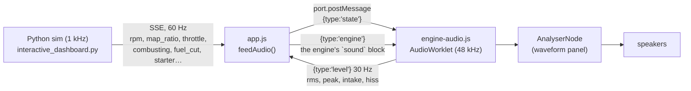

# EngineSim

A physically-based internal combustion engine simulator with a real-time browser cockpit and a synthesized engine sound. Engine speed is computed as a **consequence of torque balance**, not as an independent variable, and the same engine file drives the physics, the animation and the sound.

Physics is grounded in John B. Heywood's *Internal Combustion Engine Fundamentals* (McGraw-Hill, 1988), summarised in [`ENGINE_KB.md`](ENGINE_KB.md). Every implemented equation is tagged against the knowledge base in [`KB_GAPS.md`](KB_GAPS.md) as **SUPPORTED BY KB / DERIVED FROM KB / AUTHORED / ASSUMPTION**. Check there before trusting a claim about where a number comes from.

This README is the single guide to the whole project. It replaces the former `README.md`, `README_COMPLETED.md`, `ENGINEERING_REPORT.md`, `ENGINE_CONFIG.md` and `AUDIO.md` (kept in [`docs_archive/`](docs_archive/)).

**Governing equation**

```
(I_E + I_L) · dω/dt = T_indicated − T_friction − T_pumping − T_accessory − T_load
```

## Contents

1. [Quick start](#1-quick-start)
2. [How the engine model works](#2-how-the-engine-model-works)
3. [Engine files (one place to tune an engine)](#3-engine-files-one-place-to-tune-an-engine)
4. [Interactive dashboard](#4-interactive-dashboard)
5. [Dyno: test setup, sweep and torque/power curve](#5-dyno-test-setup-sweep-and-torquepower-curve)
6. [Sound synthesis](#6-sound-synthesis)
7. [Feature flags and `EngineConfig`](#7-feature-flags-and-engineconfig)
8. [Telemetry, experiments and tests](#8-telemetry-experiments-and-tests)
9. [Equation provenance and assumptions](#9-equation-provenance-and-assumptions)
10. [History: fixes and version notes](#10-history-fixes-and-version-notes)
11. [Limitations and next steps](#11-limitations-and-next-steps)
12. [Project structure](#12-project-structure)
13. [Use from the vehicle simulator](#13-use-from-the-vehicle-simulator)

Related documents: [`KB_GAPS.md`](KB_GAPS.md) (KB provenance and gaps) · [`UPDATES.md`](UPDATES.md) (resolved-model status, defect log, open items)

---

## 1. Quick start

```bash
pip install pyyaml                      # only needed for the legacy YAML config
python -m pytest tests/                 # 207 tests (or run tests/test_engine.py etc. directly)
python run_experiments.py               # six engine-only experiments -> output/*.csv
python run_resolved_cycle.py --engine 1nz --rpm 3000   # one crank-resolved cycle + energy audit (§2.3)
python run_benchmark.py                 # real-time factor of every engine across its speed range (§2.3); --python times the pure-Python core
python interactive_dashboard.py         # opens http://127.0.0.1:8080
python interactive_dashboard.py --engine vr38 --port 8080 --no-browser
```

- Engines shipped in `config/engines/`: `454` (Chevrolet 454 V8), `1nz` (Toyota 1NZ-FE 1.5 L I4), `vr38` (Nissan GT-R VR38DETT-inspired 3.8 L V6). `--engine` also accepts a path to any `.toml` file.
- In the dashboard click anywhere or press any key to enable sound, then hold **S** to crank, use **Q W E R** or **Space** for throttle, and press **H** for every shortcut.
- Requires Python 3.11+ (`tomllib`). The dashboard server is stdlib only; the page is plain HTML/CSS/JS with system fonts, no build step, no network.
- **Optional C compiler.** If `gcc`, `cc` or `clang` is on the machine, the resolved core's inner loop is compiled the first time it is needed (a second or two, cached in the temp directory) and runs ≈ 30× faster (§2.3 *Speed*). Without one the simulator silently uses the identical pure-Python loop. `ENGINESIM_NATIVE=0` forces Python; the dashboard banner says which core is running.

---

## 2. How the engine model works

### 2.1 Architecture

```
EngineInput (throttle, load_torque, ignition, starter)
    │
    ▼
┌───────────────────────────────────────────────────────────┐
│  ENGINE                                                   │
│  p_i(throttle)  → intake pressure          [air_model / manifold_model]
│  η_v(ω)         → volumetric efficiency    [air_model]
│  m_air = η_v·ρ_i·V_d → trapped mass        [air_model]
│  m_fuel = m_air / AFR                      [fuel_model, fuel_film, lambda_controller]
│  Otto cycle: compress → heat release → expand
│      → W_net → T_indicated                 [combustion_model, spark_model, heat_transfer]
│  T_friction(ω)  ← rubbing mep              [config / friction_breakdown]
│  T_pumping      ← intake vacuum / backpressure
│  T_accessory    ← water / oil pump, speed-scaled
│  α = (T_ind − T_fric − T_pump − T_acc − T_load) / (I_E + I_L)
│  ω += α·dt      (forward Euler)            θ += ω·dt  (0–4π, 4-stroke)
└───────────────────────────────────────────────────────────┘
    │
    ▼
EngineOutput (rpm, torque breakdown, power, AFR/λ, cylinder p/T, efficiency, …)
```

Angular velocity ω and crank angle θ are the only integrated states. Air, fuel, combustion and friction sub-states are recomputed each timestep from ω and the inputs.

That diagram is the **cycle-averaged** path (the `EngineConfig` default, `use_resolved_cylinders = false`): fast, and what you get when the flag is off. **All three shipped engine files set `use_resolved_cylinders = true`**, which swaps the middle of it — volumetric efficiency, the Otto cycle, the pumping and wall-loss estimates — for the crank-angle-resolved core in §2.3, which now drives the engine for real.

### 2.2 Implemented systems

**Core physics**

| System | Description | Reference |
|---|---|---|
| Crankshaft dynamics | Forward-Euler integration of speed and crank angle; no reverse rotation | KB Eq 14.52 |
| Piston kinematics | Crank-slider displacement, velocity, acceleration, cylinder volume | KB Eq 2.5, 2.6, 2.11 |
| Cylinder geometry | Bore, stroke, rod length, compression ratio, clearance volume | KB Eq 2.1–2.8 |
| Thermodynamics | Polytropic compression/expansion (n = 1.32 / 1.28), ideal gas, temperature-dependent cv/cp/γ from NASA-polynomial fits (`gas_properties.py`) | KB A13, Eq 4.12, 4.39–4.41 |

**Air intake and manifold**
- Instantaneous intake-pressure model (nonlinear throttle curve), or with `use_manifold_dynamics=True` a throttle-plate orifice-flow plus manifold filling/emptying ODE (`manifold_model.py`) giving real throttle-response lag. KB Eq 7.18–7.22. The throttle area follows the butterfly `1 − cos θ` law.
- Speed-dependent volumetric efficiency (peaks, then falls at high speed from choking); trapped mass `m = η_v·ρ·V_d` per cycle, flows use `N/n_R`.

**Fuel delivery**
- Fuel mass per cycle from trapped air and target AFR; lambda and equivalence ratio.
- **Fuel-film wall-wetting** (`fuel_film.py`, `use_fuel_film`): wall film with its own evaporation time constant; reproduces the lean spike on rapid throttle opening. KB Eq 7.25–7.27.
- **Closed-loop lambda control** (`lambda_controller.py`, `use_lambda_controller`): simulated Nernst O₂ sensor plus integral fuel trim reacting to the previous cycle's actual AFR. KB Eq 7.15–7.17.

**Combustion (air-standard Otto cycle)**
- Four phases over 720°: intake, compression, power, exhaust. Constant-volume heat addition with temperature/composition-dependent cv.
- Cycle-averaged indicated torque scaled to the whole engine: `T = W/(4π)` per cylinder-cycle, `× num_cylinders`.
- **Wiebe mass-fraction-burned** (`wiebe_mass_fraction_burned`, KB Eq 9.28 / 14.32): drives the heat-release rate on the resolved core (`use_resolved_cylinders`); diagnostic and phasing only on the default cycle-averaged path.
- **MBT spark timing** with a torque penalty for deviation; **knock model** (Livengood-Wu integral over the Douaud-Eyzat ignition-delay correlation, KB Eq 9.60–9.64) that retards torque once the integral reaches 1.0, sensitive to octane and compression ratio.
- **Cyclic variability** (`cyclic_variability.py`): per-cycle Gaussian scatter sized by a COV_imep model sensitive to φ, EGR and load (KB Eq 9.50).
- **Diesel/CI mode** (`engine_type="CI"`): ignition-delay plus premixed-fraction path overriding SI torque. The full two-phase Watson model exists in `diesel_combustion.py` (KB Eq 14.46–14.50) but is not the path the CI branch uses.

**Heat transfer** (`heat_transfer.py`, `use_heat_transfer`): Woschni and Annand correlations (KB Eq 12.14, 12.16–12.19). **On the active cycle-averaged path this is now diagnostic-only** — see §2.3 for why, and for where wall heat loss actually participates in the energy balance.

### 2.3 The crank-angle-resolved model (`use_resolved_cylinders`)

> **Status: integrated; on in all three shipped engine files.** With `use_resolved_cylinders = true` (SI engines) `Engine.update()` hands each timestep to `CylinderBank`, which integrates every cylinder's gas over the crank angle it sweeps. Torque, manifold pressure, exhaust backpressure, volumetric efficiency, pumping loss and wall heat loss are then *outputs*, not tables. `EngineConfig` defaults the flag to off and the shipped files turn it on; set `use_resolved_cylinders = false` in an engine file to get the fast cycle-averaged path back (~10× cheaper). `UPDATES.md` is the full engineering log, including every defect found along the way.

> **v0.7** added what the earlier limitations list asked for: the **turbocharger as real components in the exhaust path** (next block), a **two-zone burn** with a physical end-gas temperature, **variable valve timing**, a **misfire / partial-burn model** and a **compiled C inner loop** (*Speed*, below).

| Module | Role |
|---|---|
| `cylinder_bank.py` | **The resolved core.** Owns one `Cylinder` per cylinder (each at its own phase from `firing_order` / `firing_intervals_deg`), the exhaust plenum, the intake manifold pressure and (with `use_turbo`) the turbocharger; steps them together in substeps, learns the ECU's air model, and holds the real-time governor |
| `cylinder.py` | Per-cylinder state and the hot-path substep: gas exchange, first law with a burned-mass fraction, Wiebe heat release with burn-quality/misfire, two-zone flame, Woschni wall loss, torque, NO, knock integral, cam phase, a recorded pressure trace. Table-driven (volume, valve area, c_v, u) with the arithmetic inline |
| `gas_tables.py` | c_v and internal-energy tables for air, the unburned petrol-air mixture and **equilibrium burned gas** (KB Fig 4-15, dissociation included) |
| `valve_profile.py` | Cam lift vs crank angle from the file's open/close angles, lift and ramp fractions. One profile object serves the physics, the dashboard plot and the cam animation |
| `valve_flow.py` | Reference implementation of the signed compressible valve flow (KB Eq 7.18–7.20) and the flow area `min(π·D·L·cos β, π·D_port²/4)` (KB Eq 6.7). The cylinder inlines the same relations on tables; tests cross-check them |
| `exhaust_system.py` | Lumped plenum fed by every exhaust valve. Drained through a restricted tail-pipe orifice, or — with a turbo — through a **turbine ‖ wastegate** stage into a post-turbine volume and then the tail pipe |
| `turbo_system.py` | The turbocharger as components: compressor speed-line map, shaft energy balance, charge-air volume with check-valve bypass and blow-off valve, PI wastegate control |
| `native_core.py`, `native/enginecore.c` | Optional **compiled inner loop**: a line-for-line C transcription of the cylinder substep, the exhaust/turbine stage and the bank loop; `NativeCylinderBank` runs it and falls back to Python when there is no compiler |
| `piston_kinematics.py` | Exact `V(θ)` / `dV/dθ` from bore, stroke and rod length (KB Eq 2.5/2.6) |
| `heat_transfer.py` | Woschni (KB Eq 12.16–12.19): kPa basis, `T^-0.55`, C₁ per phase (6.18 gas exchange / 2.28 otherwise), displaced-volume V_d, polytropic motored pressure; disc-chamber surface area that follows the piston |

**One engine timestep.** The crank angle swept (`ω·dt`) is cut into substeps. On every substep:

```
throttle flow in  →  each cylinder breathes from the manifold / exhales into the exhaust plenum
                  →  manifold and exhaust pressure move by the mass that actually crossed
```

so a neighbour's intake stroke pulls the manifold down, two exhaust valves open together raise backpressure, and overlap reversion and scavenging need no special case.

**One cylinder substep** (`Cylinder.step`):

1. volumes at both edges of the substep (tabulated, 0.25°) give the swept `ΔV`;
2. signed valve flow from the pressure difference and the tabulated cam-lift area, evaluated with a **predictor-corrector** (second order) and **limited to the mass that would equalise the two sides**, so an explicit step cannot overshoot and ring;
3. the Wiebe burn releases `Δx·Q` — each substep's share of the *whole* charge energy, so the heat release follows the curve and sums to exactly `Q`;
4. open-system first law at constant volume, `m'·c_v·ΔT = Σ dm·(h − u) + Q_chem − Q_wall − m'·Δu_composition`, where the gas is a mixture of unburned charge and **equilibrium burned products** tracked by the burned mass fraction `y` (c_v from `gas_tables.py`, at the mid-step temperature);
5. reversible compression/expansion applied *exactly* with the mean c_v of the step: `T·V^(R/c_v) = const`, and the work the gas does is `W = m·c_v·(T_before − T_after)`, so the torque integral cannot disagree with the first law at any substep size;
6. torque `= (W − p_crankcase·ΔV)/Δθ`, split into gross and pumping (intake + exhaust strokes) so `gross = indicated + pumping` and pumping is subtracted from the crank once.

A substep with both valves shut and no burn due (≈ a third of the cycle) takes a short path that skips the flow and composition bookkeeping.

**Fuel** rides in with the air through the intake valve (so the gas mass, mixture and pressure include it, and reversion carries it back out); the burn's energy pool is sized at the spark from the fuel actually trapped. A cylinder that began its cycle on a fuel cut picks fuel up as soon as it is wanted while its intake valve is still open.

**ECU.** Fuel is metered from a speed-density air model learned from what each cylinder trapped: `m_air ∝ (a₀ + a₁·rpm)·MAP − b`, fitted online by recursive least squares (forgetting only when the operating point moves), so the slope and the residual-gas intercept follow the real engine and the mixture stays within a few percent of stoichiometric even at low manifold pressure. λ and the lambda controller read the *measured* fresh air (the unburned part of the charge less its fuel). Closed-throttle idle is held by a **fast-idle ramp** (the target starts 50 % high at the first fire and decays with a 4 s time constant, as a real ECU does), a **spark trim** (`idle_spark_gain_deg_per_rpm`), and a slow idle-air valve with limited trim authority and a floor, held at its idle position during a fuel cut (dashpot) and while cranking. Decel fuel cut waits `dfco_after_start_delay_s` after the first fire so the start-up flare is not cut. Knock (`use_knock_model`) is Livengood-Wu on the unburned end gas of every cylinder and **retards the spark** (`knock_retard_step_deg` per event, recovering at `knock_retard_recovery_deg_per_s`) instead of scaling torque.

**Turbo, two-zone, VVT, burn stability (v0.7).**

- *Turbo.* With `use_turbo` the exhaust plenum no longer drains through a fixed tail orifice. It drains through a **turbine** (an orifice of `turbo_turbine_area_m2` that extracts `Ẇ = η·ṁ·c_p·T₃·[1 − (p₄/p₃)^((γ−1)/γ)]` from the gas, KB Eq 6.44–6.48) **in parallel with a wastegate** (`turbo_wastegate_area_m2` × its opening) into a post-turbine volume, then the tail pipe. The shaft obeys `½·I·dω²/dt = η_m·Ẇ_T − Ẇ_C`, the compressor is a scalable speed-line map (`turbo_design_*`) feeding a charge-air volume (`turbo_boost_volume_m3`) that the throttle drains, with a check-valve path round an unspun compressor and a blow-off valve on throttle lift. A **PI wastegate law** holds the boost at `turbo_target_boost_pa` without hunting. So boost and backpressure are one coupled system: asking for boost raises the pressure the exhaust valves push against (the pumping loss and the residual gas go up with it) and opening the wastegate relieves both; lag is the shaft inertia against the surplus turbine power, not a time constant. Twin-turbo engines are one turbo with the flow, area and inertia of the pair (`turbo_count`). The VR38 shipped file is now genuinely turbocharged.
- *Two-zone.* While a flame burns with both valves shut (`use_two_zone`, default on) the cylinder is solved as an **unburned zone** and a **burned zone** at a common pressure: each substep the flame converts `dx·m` of unburned gas to products at the adiabatic flame temperature (an enthalpy balance on the tabulated gases), both zones are compressed or expanded isentropically to the pressure at which they fill the new volume, the wall takes heat from each by its excess temperature, and the work on the piston is what the first law leaves. Two things follow that a mean-temperature gas cannot give: the **end-gas temperature** that the Livengood-Wu knock integral integrates (it is only ever compressed, never burned and re-expanded), and the **burned-zone temperature** NO forms at (extended Zeldovich, KB Eq 11.11, tracked per cylinder; `EngineOutput.nox_ppm`). Net work agrees with the single-zone gas to within a few percent; peak pressure at MBT is about 10 % lower, and burned-zone peaks are 2700–2900 K.
- *VVT.* A **cam-phase** input shifts a cylinder's whole intake and exhaust lift curves by the cam advance (`vvt_*` keys in the file: min/max advance, slew rate, `vvt_auto` schedule; `Controls.vvt_override` for the dashboard). Valve events, overlap, intake closing and the knock window all follow, since the area tables are indexed at `angle + advance`. The ECU schedules the intake cam from speed and load; the measured effect is the textbook one — with a late-closing cam, advancing it closes the intake earlier and fills better at low speed, while over-advancing hurts high-speed filling.
- *Burn stability.* Burn quality `q` falls from 1 to 0 between pairs of limits on the residual (burned) mass fraction at the spark (`burn_residual_lo/hi` 0.14 → 0.44), on λ lean (`burn_lean_lo/hi` 1.30 → 1.75) and on λ rich (`burn_rich_lo/hi` 0.80 → 0.50); the lowest of the three scales the released energy and stretches nothing else, and below `burn_misfire_quality` (0.15) the cycle does not burn at all (a **misfire**: the charge goes out unburned, `EngineOutput.misfire_rate`). Overlap reversion now pushes *burned* gas up the intake runner, which waits there and is drawn back first, so the residual fraction is physical. At idle the manifold pressure therefore settles where the flame can still burn (about 23 kPa on all three engines, residual ≈ 16 %), instead of at whatever very low pressure the old model idled at.

**Measured behaviour**, one cylinder, 3000 rpm, 0.91 bar intake, stoichiometric, 1° substeps (`tests/test_resolved_physics.py`; torque in N·m):

| Spark BTDC | Indicated | Pumping | Gross | Peak p | Peak T (mean) | Burned-zone T | Wall Q | η_ind |
|---|---|---|---|---|---|---|---|---|
| 45° | 37.5 | 1.1 | 38.6 | 73.2 bar | 2794 K | 2911 K | 317 J | 32.1% |
| 35° | 40.8 | 1.1 | 42.0 | 64.4 bar | 2687 K | 2862 K | 270 J | 34.9% |
| 25° | 41.9 | 1.2 | 43.1 | 52.6 bar | 2599 K | 2806 K | 232 J | 35.9% |
| 15° | 40.6 | 1.2 | 41.7 | 40.3 bar | 2545 K | 2749 K | 204 J | 34.8% |
| 0° | 35.3 | 1.2 | 36.4 | 25.7 bar | 2520 K | 2686 K | 180 J | 30.3% |

Peak pressure falls monotonically as the spark retards and torque traces an interior MBT curve near 20–25°. Peak mean temperature sits at 2500–2800 K (the burned zone a little above, 2700–2900 K) and indicated efficiency peaks at 36 % — both inside the real SI range; wall loss is 13–24 % of fuel energy. The single-zone gas (`use_two_zone = false`) gives the same curve within 1–3 % in torque and ~8–10 % higher peak pressure. (Before the equilibrium burned-gas properties and the heat-release fix of v0.6 these were 3400 K and 42 %.)

**Whole-engine behaviour** (`python -m pytest tests/`; dyno-held WOT after a 3 s settle, compiled core at 1° substeps, 2 ms step; the VR38 is turbocharged to 200 kPa absolute):

| Engine | rpm | Torque | Power | VE | Manifold | Exhaust p | PMEP | Peak p | Cycle-averaged path |
|---|---|---|---|---|---|---|---|---|---|
| 1NZ-FE 1.5 L | 1600 | 125 N·m | 28 hp | 0.89 | 101 kPa | 102 kPa | 0.03 bar | 57 bar | 144 N·m |
| | 3200 | 112 | 50 | 0.85 | 101 | 104 | 0.15 | 52 | 117 |
| | 4800 | 97 | 65 | 0.84 | 101 | 106 | 0.41 | 56 | 82 |
| | 6100 | 77 | 66 | 0.81 | 100 | 109 | 0.68 | 56 | 39 |
| Chev. 454 | 1400 | 582 | 114 | 0.88 | 101 | 103 | 0.10 | 47 | 622 |
| | 2800 | 509 | 200 | 0.85 | 100 | 106 | 0.40 | 42 | 498 |
| | 4100 | 402 | 231 | 0.79 | 100 | 109 | 0.74 | 41 | 334 |
| | 5200 | 283 | 207 | 0.71 | 99 | 112 | 1.00 | 39 | |
| VR38 3.8 L V6 turbo | 1800 | 663 | 168 | 0.94 | 206 | 158 | −0.37 | 96 | |
| | 3500 | 570 | 280 | 0.87 | 206 | 193 | 0.28 | 87 | |
| | 5200 | 485 | 355 | 0.82 | 205 | 208 | 0.97 | 90 | |
| | 6600 | 391 | 362 | 0.77 | 204 | 224 | 1.63 | 87 | |

λ is within 1 % of stoichiometric everywhere. The VR38 holds its 200 kPa boost within ~3 % at every speed (the exhaust plenum sits at 1.5–2.0× the post-turbine pressure — the backpressure that costs it pumping work, PMEP 0.3 → 1.6 bar), and its turbo shaft runs at 110–150 krpm. Torque and power fall off above ~4000 rpm more than the real engines (which have tuned intakes and exhausts): the model has no wave dynamics. The VR38's low-speed torque is too high — the turbine is well matched at 1800 rpm and nothing limits boost by knock — and enabling `use_knock_model` on it drives the retard to its 15° limit everywhere (−8 to −10 % torque; the Douaud-Eyzat delay is calibrated for naturally aspirated charge conditions), which is why it is off in that file. `python run_resolved_cycle.py` prints the energy audit for a chosen point: 1NZ at 3000 rpm WOT puts 39.4 % of the heat release into net work, 16.3 % through the walls and 44.3 % out of the exhaust. **Idle** (cold start, starter released at 1.5 s, last 10 s of 35 s): 1NZ 801 ± 17 rpm, 454 661 ± 6, VR38 751 ± 12, all near 23 kPa manifold pressure with no misfires.

**Enabling it.** In the engine file: `[engine] use_resolved_cylinders = true`. The shipped files already carry per-valve diameters, lifts, exhaust sizing and idle tuning (§3.3; approximate figures, tune them). It needs a starter that can beat the compression stroke (`starter_stall_torque_nm` ≈ 100+ N·m per litre of displacement; the shipped files are set for it). `use_heat_transfer`, the VE table and the manifold-dynamics flag are not used in this mode (the core always integrates its own manifold); `engine_type = "CI"` keeps the cycle-averaged path. `use_turbo = true` in a resolved engine builds the turbine/compressor/wastegate components from the `turbo_*` keys (the cycle-averaged turbo model of §2.3 *Turbocharging* is what the other path uses).

**Speed — and the real-time guarantee.** Cost is *cylinder-substeps per second*. In CPython one costs ≈ 16 µs (≈ 13 µs with the valves shut, ≈ 25 µs through the gas exchange) — about the interpreter's floor, so the pure-Python core is bounded two ways:

- `max_cylinder_steps_per_ms` (default 32) caps substeps × cylinders per millisecond of simulated time, so every engine costs about the same per unit time: an 8-cylinder takes 4 substeps per millisecond at speed, a 4-cylinder 8. Below ~3000 rpm `crank_angle_resolution_deg` (4°) is the limit instead. Coarser substeps cost accuracy gracefully (single cylinder: net torque +5 %, peak pressure −11 % between 1° and 12°).
- **The real-time governor** (`CylinderBank.set_time_budget`, switched on by the dashboard): the bank times itself and, when it runs over its share of the wall-clock budget, trims that cap (floor: 2 substeps per cylinder), restoring it by an eighth per 12 steps when there is headroom. Off (scripts, tests) the solver is deterministic.

**The compiled core** removes the interpreter from that loop. `native/enginecore.c` is a line-for-line transcription (same arithmetic, in the same order, built with `-O2 -ffp-contract=off` and no fast-math) of `Cylinder.step` — flows with the predictor-corrector and equalisation limiter, Wiebe burn with burn quality, runner buffer, single- and two-zone first law, NO and knock — together with `begin_cycle`, the exhaust plenum and turbine stage, the boost plenum and the throttle/manifold ODE. `NativeCylinderBank` packs each cylinder's attributes into a flat array, runs the whole step's substep loop in C and writes them back, so every Python reader (engine, dashboard, tests) is unchanged and the ECU, RLS air-model learning, shaft and wastegate stay in Python. The layout header is generated from the Python attribute lists at build time, and the library is cached by source hash. **It agrees with the Python core to rounding**: the parity tests (`tests/test_native_core.py`) drive both through fired cycles, motoring and fuel resume, WOT with two-zone and knock, misfire, cam phasing, the shipped engines and the turbo, and compare 8 outputs per step plus every cylinder's state at 1e-9 relative (most scenarios agree bit for bit). Because a substep costs ≈ 0.6 µs instead of 16, `use_native_core` also raises the budget (`native_steps_per_ms` = 600) and the resolution (`native_crank_angle_resolution_deg` = 1°), so the compiled core is both ≈ 30× cheaper per substep *and* at least 4× finer.

`python run_benchmark.py` prints the real-time factor (simulated seconds per CPU second) per engine at idle, 25/50/75/95 % of redline, WOT and closed throttle; `--dt` sets the physics step and `--python` times the pure-Python core. At the dashboard's 2 ms step (full-throttle points; CPU time, with other programs running, ±15 %):

| | idle | 25 % | 50 % | 75 % | 95 % | worst |
|---|---|---|---|---|---|---|
| 1NZ I4, compiled (1° substeps) | 4.9× | 5.0× | 4.2× | 3.5× | 3.3× | **3.3×** |
| 454 V8, compiled | 3.9× | 3.8× | 3.1× | 2.6× | 2.2× | **2.2×** |
| VR38 V6 turbo, compiled | 4.1× | 3.8× | 3.3× | 2.3× | 2.6× | **2.3×** |
| 1NZ, pure Python (governed substeps) | 4.6× | 2.7× | 1.6× | 1.1× | 1.0× | 1.0× |
| 454, pure Python | 3.5× | 1.7× | 1.1× | 1.1× | 1.0× | 1.0× |
| VR38, pure Python | 3.3× | 1.7× | 1.1× | 1.0× | 1.1× | 1.0× |

So with the compiled core every engine runs at ≥ 2× real time across its range at *finer* substeps than the Python core manages at any speed; the pure-Python core still keeps the clock (via the governor) at the price of coarser substeps near redline. What is left of the cost is Python glue (the ECU and `Engine.update` ≈ 40 %) and the attribute copy in and out of the C arrays (≈ 25 %); the C loop itself is about a third of it.

**Why wall heat loss is not charged on the cycle-averaged path.** Woschni needs gas pressure and temperature *at each crank angle*. The cycle-averaged path only has the air-standard Otto peak state, which is itself unphysical (T3 ~ 4400 K, 152 bar), and integrating against it zeroes the net work and stalls the engine. So that path reports wall loss as a diagnostic only; the resolved cylinders do the real thing inside their first law.

**Friction and losses**

| Component | Model | Reference |
|---|---|---|
| Rubbing friction (lumped) | quadratic mep `tfmep = C1 + C2·N + C3·N²` (N in rev/min) | KB Eq 13.5 |
| Friction breakdown | Bishop-style piston/ring, journal bearing (Petroff/Sommerfeld), valvetrain, valve-pumping mep (`use_friction_breakdown`) | KB Eq 13.13, 13.18–13.25 |
| Pumping (lumped) | NA SI throttling from intake vacuum and exhaust backpressure | derived |
| Accessories | water/oil pump baseline (~8 kPa) scaled with speed | KB §13.7 (qualitative), baseline authored |

**Turbocharging** (`use_turbo`). *Cycle-averaged path* (`turbo_model.py`): compressor/turbine isentropic-efficiency power model, compressor efficiency map, shaft dynamics, wastegate control; boost feeds the intake path, including the manifold ODE. *Resolved core* (`turbo_system.py` + `exhaust_system.py`): the turbine, wastegate, compressor, charge-air volume and shaft are real components coupled through the flows the cylinders produce (see *Turbo, two-zone, VVT, burn stability* above). KB Eq 6.38–6.49, 14.51.

**Emissions** (`emissions_model.py`, `compute_emissions`): NOx (extended Zeldovich), CO oxidation kinetics, crevice/wall-quench HC. On the cycle-averaged path single-evaluation estimates; on the resolved core NO is **integrated through the cycle in the burned zone** at its own temperature (two-zone) and the exhaust NOx uses that, with HC/CO following the burn quality. KB Eq 11.1–11.13, 11.21–11.22, 11.27–11.31.

**Control and run state** (authored ECU behaviour, not KB)
- **Ignition / starter / stall**: starter motor with a linear DC torque–speed line; the ECU needs `crank_revs_to_fire` (1.5) revolutions for sync before the first fire; below `stall_rpm`, unassisted, sync is lost and the engine dies (restart by cranking, or bump-start by driving it back above `stall_rpm`).
- **Engine braking**: closed-throttle deceleration comes only from friction + pumping + accessory losses with **decel fuel cut-off** (DFCO, enter/resume hysteresis `dfco_enter_ratio` / `dfco_resume_ratio`). The torque-mode idle governor acts only while idling and can at most cancel combustion torque.
- **Idle governor**: PI controller when the throttle is closed (below ~1.5× idle). Optional **idle-air control** (`use_idle_air_control`, needs `use_manifold_dynamics`): a PI-driven bypass valve parallel to the throttle that holds its position during decel (dashpot), so idle torque comes out of airflow physics.
- **Rev limiter**: `limiter_type="fuel_cut"` cuts fuel at redline and resumes below redline − hysteresis, so speed bounces off the limiter; `"torque_cut"` clamps.
- **Negative load**: `EngineInput.load_torque` may be negative (the driveline motoring the engine).

**Powertrain** (`powertrain.py`): friction clutch (lock/slip with momentum-conserving lock-up, optional auto-clutch), gearbox, vehicle (mass, aero drag, rolling resistance, brakes), a **speed-holding dyno** (a PI controller that absorbs or motors, up to 2000 N·m), and fuel/distance accounting. Vehicle parameters are authored (KB does not cover drivetrains).

### 2.4 What this is not

- **Cycle-averaged unless you ask.** By default the running engine does a lumped constant-volume Otto-cycle calculation once per timestep; the Wiebe and spark models then only drive a phasing/knock correction. Turn on `use_resolved_cylinders` (§2.3) for the crank-resolved core.
- **Volumetric efficiency is a lookup on the default path.** On the resolved core it is measured from the valves, ports and plenums (and then learned by the ECU for fuel metering).
- **No gas-dynamic wave action.** Even the resolved core treats the manifold and exhaust as lumped plenums: no runner tuning, no pulse tuning, no ram. High-rpm torque is therefore below a real tuned engine's. Dissociation, by contrast, *is* modelled in the resolved core (equilibrium burned-gas properties), which is what keeps its peak temperature and efficiency realistic.
- **Not validated against dyno data.** Numbers are sanity-checked for order of magnitude and sign of derivative, not calibrated to a real engine's measured curve.
- **Simple vehicle model**: no tyre slip, driveline compliance or hills.
- **Idle MAP.** The cycle-averaged path idles at ~15–19 kPa (real engines ~30); wall loss there is diagnostic only (see §2.3). The resolved core has the burn-stability limit, so it idles at ~23 kPa with 16 % residual and no misfires, a little below a real engine's ~30 because it still has no crevice or blow-by losses.
- **Sound is synthesized from simulated events**, not solved acoustically: timing, strength and pipe resonances follow the simulation; the waveforms are authored.
- No C++ implementation exists in this repository (an old README described a `v02/` port that is not on disk).

---

## 3. Engine files (one place to tune an engine)

Every engine is **one TOML file** in [`config/engines/`](config/engines/). That single file drives the physics, the animation and the synthesized sound.

| File | `--engine` | Engine |
|---|---|---|
| `chevrolet_454.toml` | `454` | Chevrolet 454 V8, dual exhaust, M21 4-speed, 5500 rpm redline |
| `toyota_1nz_fe.toml` | `1nz` | Toyota 1NZ-FE 1.5 L inline-4, single exhaust, 5-speed, 6400 rpm redline (real 75 × 84.7 mm geometry) |
| `Nissan_Gt_R35.toml` | `vr38` | Nissan GT-R VR38DETT-inspired 3.8 L V6, dual exhaust, 6-speed, 7000 rpm redline |

### 3.1 Workflow

```
python interactive_dashboard.py --engine 454          # or --engine path/to/my_engine.toml
```

1. Open the engine file in any editor next to the dashboard.
2. Change a number and **save**. Within about a second the dashboard applies it: the engine keeps running, the sound changes, the animation and plots follow (the top bar flashes "Engine file reloaded").
3. On a mistake a **red banner** explains it (file, section, key, "did you mean…?" for typos; syntax errors include the line number). The **previous settings keep running** until the file is valid again, then it recovers by itself.

Other ways in:
- **Validate without the dashboard:** `python -m engine_sim.engine_file [file.toml …]` prints firing frequency at idle and redline, exhaust length and the pipe's quarter-wave ring pitch.
- **Reload now:** the file button in the top bar. **Reset** (Backspace) restarts from the *current file contents*.
- **New engine:** copy a file, change `id` and `name`, edit. It appears in the engine picker (`V` cycles engines).
- From Python: `from engine_sim.powertrain import load_engine; ecfg, vcfg = load_engine("454")`, or `load_config("x.toml")` for just the `EngineConfig`.

### 3.2 File layout

Top level: `id`, `name`, `description`. Then sections; comments in the shipped files say what each setting sounds like. **Unknown keys are errors** (with a suggestion), so a typo can never be silently ignored.

| Section | Goes to | Notes |
|---|---|---|
| `[engine]` | `EngineConfig`, same name | any field of [`config.py`](engine_sim/config.py) |
| `[layout]` | `EngineConfig` | firing order, banks, odd-fire intervals |
| `[valves]` | `EngineConfig` | valve timing |
| `[exhaust]` | `EngineConfig.exhaust_<key>` | pipe geometry |
| `[intake]` | `EngineConfig.intake_<key>` | runner |
| `[sound]` | `EngineConfig.sound_<key>` | taste parameters |
| `[vehicle]` | `VehicleConfig` | mass, gearing, clutch, drag |

### 3.3 Reference

**`[engine]`**

| Key | Unit | What it does | Also heard/seen as |
|---|---|---|---|
| `bore_m`, `stroke_m`, `rod_length_m` | m | cylinder geometry, displacement | smaller bore → sharper, brighter blowdown (τ = k·bore/c) |
| `compression_ratio` | – | thermodynamics | torque, peak pressure plots |
| `num_cylinders` | – | must match `[layout]` | firing frequency = N·rpm/120 |
| `engine_inertia_kgm2` | kg·m² | crank + flywheel + clutch | **idle lope**: heavy = smooth, light = lumpy and quick to rev |
| `idle_rpm`, `stall_rpm`, `redline_rpm` | rpm | `stall < idle < redline` | limiter bounce, pitch range |
| `limiter_type`, `limiter_hysteresis_rpm` | – / rpm | `"fuel_cut"` bounces, `"torque_cut"` clamps | limiter chatter |
| `max_volumetric_efficiency`, `manifold_volume_m3`, `throttle_max_area_m2` | – / m³ / m² | air path | throttle response, vacuum |
| `use_idle_air_control`, `iac_*`, `dfco_enter_ratio`, `dfco_resume_ratio` | | idle control, decel fuel cut | engine braking |
| `starter_stall_torque_nm`, `starter_free_speed_rpm` | N·m / rpm | starter motor | how it cranks |

Every other `EngineConfig` field (friction, heat transfer, turbo, fuel film, …) can be set here too; defaults in `config.py` apply to anything left out.

**`[layout]`**

| Key | Meaning |
|---|---|
| `firing_order` | cylinder numbers 1..N, each once |
| `cylinder_bank` | bank (0, 1) of each cylinder; decides which pipe it feeds when the exhaust is `dual` |
| `bank_angle_deg` | V angle (0 = inline); animation |
| `firing_intervals_deg` | optional; crank degrees between successive firings in firing order, N values summing to 720. Omit for even firing; set for odd-fire engines (e.g. `[270, 90, 270, 90]`) |

**`[valves]`** (crank degrees): `intake_open_btdc_deg`, `intake_close_abdc_deg`, `exhaust_open_bbdc_deg`, `exhaust_close_atdc_deg` (0–90). They drive the valve-lift plot and animation, the cylinder-pressure plot, and **when each exhaust and intake pulse is generated** in the sound.

Valve geometry and cam shape, used by the resolved core (§2.3; these keys are accepted in `[valves]`, and are validated: positive sizes, ramps that add up to 1, discharge coefficients in (0, 1]). Diameters are **per valve**; `[engine] num_valves_per_cyl` (4 → 2 intake + 2 exhaust, 3 → 2 + 1, 2 → 1 + 1) sets how many.

| Key | Default | Meaning |
|---|---|---|
| `intake_max_lift_m`, `exhaust_max_lift_m` | 9.5e-3 | peak valve lift. |
| `intake_ramp_open_frac`, `intake_ramp_close_frac` (same for `exhaust_`) | 0.5 / 0.5 | split of the event window between opening and closing; **must add up to 1**. 0.5/0.5 is the symmetric `sin²` hump; asymmetric values model a race cam (fast open, slow close, peak pushed late). The dashboard draws the same curve the physics integrates |
| `intake_head_dia_m`, `exhaust_head_dia_m` | 30 mm / 26 mm | valve head diameter, per valve |
| `intake_port_dia_m`, `exhaust_port_dia_m` | 30 mm / 26 mm | port throat diameter, per valve. Flow area is `min(head-gap, port)`, so it stops rising with lift partway through the event |
| `intake_seat_angle_deg`, `exhaust_seat_angle_deg` | 45 | seat angle β **from the valve-head plane** (Heywood Fig 6-12; 0 = flat seat, 30° and 45° are usual), *not* the included cone angle. The gap normal to the seat is `L·cos β` (KB Eq 6.7), so a shallower seat opens wider |
| `intake_discharge_coeff`, `exhaust_discharge_coeff` | 0.67 | valve discharge coefficient (0.6–0.7 typical) |

The shipped engine files carry approximate per-valve sizes for their real heads — treat them as starting points to tune.

Exhaust backpressure (the plenum every exhaust valve discharges into, and the tail pipe that drains it) is set in `[exhaust]`: `plenum_volume_m3` (15e-3), `tail_dia_m` (45e-3; the *equivalent single bore* for dual pipes — smaller means more backpressure and pumping loss), `tail_discharge_coeff` (0.70). Solver and control keys in `[engine]` (all only used by the resolved core): `use_resolved_cylinders` (default false; true in the shipped files), `crank_angle_resolution_deg` (4.0) and `max_substeps_per_update` (64) for the finest substep, `max_cylinder_steps_per_ms` (32) for the cost cap (substeps × cylinders per simulated millisecond; lower = faster and coarser at speed), `use_native_core` (true), `native_crank_angle_resolution_deg` (1.0) and `native_steps_per_ms` (600) for the compiled loop (these replace the two Python limits when it is in use), `iac_resolved_gain_scale` (0.15; the 454 file uses 0.06) and `iac_resolved_kp_fraction` (1.0) for the idle-air PI gains, `idle_spark_gain_deg_per_rpm` (0.04) / `idle_spark_reserve_deg` (0) / `idle_spark_max_advance_deg` (8) / `idle_spark_max_retard_deg` (25) for the idle spark trim, `fast_idle_extra_ratio` (0.5) / `fast_idle_decay_s` (4.0) for the start-up fast-idle ramp, `dfco_after_start_delay_s` (2.5), and `knock_retard_step_deg` (3) / `knock_retard_max_deg` (15) / `knock_retard_recovery_deg_per_s` (1.5).

Other resolved-core keys in `[engine]` (v0.7): `use_two_zone` (true); the burn-stability limits `burn_residual_lo/hi` (0.14/0.44), `burn_lean_lo/hi` (1.30/1.75), `burn_rich_lo/hi` (0.80/0.50) and `burn_misfire_quality` (0.15); variable valve timing `vvt_intake_min_deg` / `vvt_intake_max_deg` / `vvt_exhaust_min_deg` / `vvt_exhaust_max_deg` (all 0 = fixed cam), `vvt_rate_deg_per_s` (80) and `vvt_auto` (true; false = the cam holds the minimum unless the controls override it); and, with `use_turbo`, the components `turbo_count`, `turbo_inertia_kgm2`, `turbo_design_speed_rps` / `turbo_design_flow_kgs` / `turbo_design_pressure_ratio` (the compressor map), `turbo_compressor_efficiency`, `turbo_turbine_efficiency`, `turbo_mechanical_efficiency`, `turbo_turbine_area_m2`, `turbo_wastegate_area_m2`, `turbo_boost_volume_m3`, `turbo_intercooler_effectiveness`, `turbo_target_boost_pa` and `turbo_wastegate_gain`, plus `exhaust_post_volume_m3` (the volume behind the turbine). The VR38 file shows a complete set.

**`[exhaust]`**

| Key | Unit | Meaning |
|---|---|---|
| `layout` | – | `"dual"`: one pipe per bank, stereo (V/flat only); `"single"`: all banks merge into one pipe |
| `header_length_m`, `mid_length_m`, `muffler_length_m`, `tail_length_m` | m | section lengths; one number = every pipe, or one per pipe (`[0.85, 1.00]`). Longer = lower pitches |
| `muffler_area_ratio` | – | muffler chamber ÷ pipe area. 1 = no chamber; bigger = quieter, more muffled |
| `muffler_body_hz` | Hz | boom of the muffler shell (one or per pipe) |
| `header_temp_k`, `mid_temp_k`, `muffler_temp_k`, `tail_temp_k` | K | gas temperature per section; speed of sound `c = 20.05·√T`. Hotter = higher pipe pitch |
| `pipe_loss` | 0–1 | gain per pass (1 = lossless). Lower = pulses die faster; subtle (≈ ±1 dB between 0.97 and 0.999) |
| `tip_damping` | 0–1 | open-end high-frequency loss. **Higher = duller, lower = brighter and rasper** |

**`[intake]`**: `runner_length_m`, `runner_temp_k` (the runner delay, i.e. the pitch of the suction "whoosh").

**`[sound]`**

| Key | Meaning |
|---|---|
| `cylinder_strength_spread` | fixed strength differences between cylinders (0.30 = ±15 %); repeat every cycle, giving the idle its lope |
| `cylinder_timing_spread_deg` | fixed exhaust-timing differences between cylinders |
| `noise_seed` | different seed → different (repeatable) set of those differences |
| `blowdown_k` | blowdown time constant = `k·bore / c(header)` |
| `crank_ripple_gain` | how much of each cylinder's work shows up as crank-speed ripple |
| `combustion_variability`, `idle_variability` | random cycle-to-cycle strength variation, and extra of it at closed throttle |
| `pop_probability` | chance of an overrun pop per exhaust event |
| `starter_ratio`, `starter_poles` | starter whine pitch: armature revs per crank rev, and motor poles |

**`[vehicle]`**: `mass_kg`, `wheel_radius_m`, `gear_ratios`, `final_drive`, `wheel_inertia_kgm2`, `gearbox_inertia_kgm2`, `cd_a_m2`, `rolling_resistance`, `clutch_capacity_nm`, `brake_max_decel_g`, `clutch_engage_rate`, `clutch_release_rate`.

### 3.4 How the file becomes sound

The server turns the engine into a **`sound` block** ([`sound_spec.py`](engine_sim/sound_spec.py)), sends it in `/api/config`, and the synth ([`dashboard/engine-audio.js`](dashboard/engine-audio.js)) builds itself from it. The JavaScript contains no engine-specific numbers.

| From the file | Becomes | You hear |
|---|---|---|
| `firing_order`, `firing_intervals_deg`, `cylinder_bank`, `exhaust.layout` | when each pulse fires and which pipe it enters | V8 burble from uneven per-bank spacing; even I4 buzz; stereo only with dual pipes |
| `[valves]` | exhaust-valve-open and intake-valve-open events | when each cylinder's "bark" starts |
| section lengths, temperatures | delay-line lengths `2L/c` | pitch and spacing of the pipe's ringing |
| `muffler_area_ratio` | reflection `(A₁−A₂)/(A₁+A₂)` at the chamber | how quiet and muffled |
| `bore_m`, header temperature, `blowdown_k` | blowdown time constant | brightness of the exhaust "crack" |
| `engine_inertia_kgm2`, `num_cylinders`, torque | crank-speed ripple `δ = g·W_cyl/(I·ω²)`, `W_cyl = T_ind·4π/N` | idle lope |
| `[sound]` spreads / variability | per-cylinder strengths, timings, randomness | character of the idle |
| `starter_ratio` / `starter_poles` | armature speed and whine harmonic | starter pitch |

Measured effect of one change on the 454 at idle (offline render of the synth):

| Change | Result |
|---|---|
| `bore_m` 108 → 75 mm | spectral centroid 336 → 534 Hz, +5.4 dB above 2 kHz (brighter) |
| `muffler_area_ratio` 6 → 14 | −4.3 dB in 20–125 Hz (quieter) |
| `muffler_area_ratio` 6 → 3 | +2.9 dB in 20–125 Hz, strongest low partial moves to 86 Hz |
| exhaust lengths ×2 / ×0.5 | strongest partial below 400 Hz moves 303 → 146 Hz / 43 Hz |
| `header_temp_k` 725 → 1100 | +2.8 dB above 2 kHz, low-mid −4.3 dB |
| `tip_damping` 0.35 → 0.10 / 0.70 / 1.0 | centroid 336 → 410 / 249 / 238 Hz; 2–8 kHz: +0.3 / −6.5 / −11.3 dB |
| `pipe_loss` 0.97 / 0.999 | about −1 / +0.3 dB (subtle) |
| `engine_inertia_kgm2` 0.45 → 0.10 / 1.2 | crank wobble at idle 1.9° → 7.5° / 0.8° peak-to-peak |
| whole 1NZ-FE file instead of 454 | centroid 539 Hz, +4.3 dB in 2–8 kHz, −5.4 dB below 125 Hz |

### 3.5 Recipes

| I want | Change |
|---|---|
| Deeper, longer drone | longer `header_length_m` / `mid_length_m` / `tail_length_m`; `pipe_loss` closer to 1 lengthens the ring slightly |
| Quieter, more refined | bigger `muffler_area_ratio`, longer `muffler_length_m` |
| Raspier, race-like | smaller `muffler_area_ratio`, **lower** `tip_damping`, hotter `header_temp_k`, smaller `bore_m` |
| Smoother idle | larger `engine_inertia_kgm2`, smaller `cylinder_strength_spread` |
| Lumpy idle | smaller `engine_inertia_kgm2`, larger `cylinder_strength_spread` (valve timing only shifts *when* pulses happen) |
| Brighter crack | smaller `bore_m`, hotter `header_temp_k` |
| More overrun pops | larger `pop_probability` |
| Single vs dual sound | `layout = "single"` merges banks into one mono pipe |

### 3.6 Legacy YAML

`config/default_engine.yaml` is the older format read by `load_config()` for `run_experiments.py`. It needs PyYAML (not a dependency); if PyYAML is missing, `load_config()` warns instead of silently using defaults. New work should use the TOML files. The default `EngineConfig` is a Toyota 1NZ-FE-like 1.5 L SI four-cylinder (bore 82.5 mm, stroke 86 mm, CR 10:1).

---

## 4. Interactive dashboard

`python interactive_dashboard.py [--engine 454|1nz|vr38|path.toml] [--port 8080] [--no-browser]`

A Python stdlib server runs the physics at **1 kHz** on a thread and streams telemetry at **60 Hz** over Server-Sent Events to `dashboard/` (`index.html`, `style.css`, `ui.js` tooltips/knobs/sound-profile spec, `app.js`, `engine-audio.js`).

### 4.1 Layout

One screen at 1280×720 and up; scrolls on shorter windows and stacks into one column on narrow ones. Top bar: engine picker, engine state, FPS / real-time ratio / physics rate / audio delay, slow motion, mute, help. Six cards:

| Card | Contents |
|---|---|
| Instruments | engine-speed and vehicle-speed dials (rev-limiter zone), throttle / clutch / brake bars, gear, lamps (ignition, starter, fuel cut, clutch lock/slip, dyno) |
| Engine | live animation (pistons, rods, crank, cams, valves, spark flash), per-cylinder firing lamps by bank |
| Sound | 14 rotary dials, 6 presets, output level meter, live spectrum analyzer |
| Driver | Ignition, hold-to-crank Start, throttle slider, gear buttons, clutch / brake / auto-clutch, dyno controls |
| Scope | audio waveform; RPM, manifold, valve-lift, cylinder-pressure, P-V, torque/power history, and the **TQ / HP vs RPM dyno curve** |
| Engine vitals | manifold vacuum (inHg), air flow (SCFM), volumetric efficiency, AFR, exhaust O₂, spark advance, torque, power, fuel used / cost / MPG / distance |

Everything has a hover tooltip (about 70 elements): every dial, gauge, lamp, button, slider, plot and chip. Dial tooltips also say what turning it down/up does and show the current and default value; they also appear on keyboard focus.

### 4.2 Keys

| Key | Action |
|---|---|
| `A` | ignition on / off |
| `S` (hold) | starter (also switches ignition on) |
| `Q W E R` (hold) | throttle 10 / 25 / 50 / 100 % |
| `Space` (hold) | pedal: throttle ramps up while held |
| `Z` / `X` | throttle setting −/+ 2 % |
| `↑` / `↓`, `1`–`4`, `N` | shift up / down, select gear, neutral |
| `Shift` (hold) | clutch pedal |
| `C` | auto-clutch on / off (off = you can stall) |
| `B` (hold) | brake |
| `D` | dyno on / off (opens the test setup, §5) |
| `←` / `→` | dyno speed ∓ 250 rpm |
| `P` | overrun pops on / off |
| `M`, `−` / `+` | mute, master volume |
| `,` / `.` | slow motion − / + (down to 1/32) |
| `V` | switch engine |
| `Backspace` | reset simulation |
| `H`, `Esc` | show / hide help |

### 4.3 Rendering

Canvas sizes are cached via `ResizeObserver`; dial faces are pre-rendered and skipped when unchanged; firing lamps share one canvas; plots and text update at 30 Hz; DOM text is only written on change; one bad widget cannot stop the frame loop. Measured ≈ 2 ms of JS per frame at 1080p (budget 16.7 ms) including the spectrum analyzer. Panels compact themselves (smaller dials, hidden hints, spectrum drops out) via container queries when short.

### 4.4 API

- `GET /api/config`: engine info, the derived `sound` block, engine list, `config_version` / `config_error`.
- `GET /api/stream`: SSE telemetry (rpm, throttle, torque/hp, MAP, AFR, spark, fuel, dyno state, …).
- `POST /api/control`: `{"controls": {...}, "action": "reset" | "reload" | "preset", "name": ..., "time_scale": ...}`. Controls map to the `Controls` dataclass in `powertrain.py` (`throttle`, `ignition`, `starter`, `clutch_pedal`, `gear`, `brake`, `auto_clutch`, `dyno_enabled`, `dyno_rpm`).

### 4.5 Browser test

`python tests/ui_check.py` (needs `pip install playwright numpy && playwright install chromium`) starts the server and drives the real page in headless Chromium. It checks tooltips, dial interaction, persistence, presets, on-screen controls, that each dial measurably changes the audio leaving the browser, and live reload of the engine file (sound changes; a broken file shows the banner; fixing it recovers).

---

## 5. Dyno: test setup, sweep and torque/power curve

The dyno is a speed-holding dynamometer in the powertrain: it applies whatever torque is needed to hold the engine at a set rpm (absorbing or motoring), and the dashboard reports that torque as the engine's measured output (`torque_nm = dyno_torque`, `hp = torque × ω / 745.7`).

**Test setup window.** Enabling the dyno (**D**, the Dyno button, or **Test setup…**) opens a modal:

| Field | Meaning |
|---|---|
| Throttle % | throttle held during the test (default 100) |
| Start / End rpm | sweep range (default start = 1.3× idle, end = 95 % of redline, to stay off the rev limiter) |
| Step rpm | rpm increment between test points (default 500, or 250 for engines under 4000 rpm) |
| Settle s | time to let the engine reach each speed (a point also waits until rpm is within 1 %, up to a timeout) |
| Measure s | averaging window per point |

It validates every field and shows the number of points and the estimated simulated time. Buttons: **Run sweep** (Enter), **Hold only** (close and hold the start speed at that throttle; use the slider or `←`/`→` afterwards), **Cancel** (Esc; turns the dyno off if the modal had just switched it on). While the modal is open, typed keys never drive the car.

**Sweep.** The page steps through each rpm in neutral with the ignition on, using simulated time (so slow motion is correct), averages torque and power in the measure window, and records `{rpm, torque, hp}`. The Driver card shows `sweep 3/10 · 2000 rpm` and a **Stop sweep** button; the throttle and dyno slider are locked until it ends. When finished the dyno switches off, your throttle setting is restored, and a toast reports peak torque and peak power with their rpm.

**TQ / HP vs RPM plot.** A plot in the Scope card shows torque (white, lb-ft) and power (teal, hp) against engine speed, with peak markers, the dashed 5252 rpm line (where `hp = torque × rpm / 5252`, so the curves must cross) and live rings while the dyno is on. The curve is cleared when you switch engine.

**Detailed view.** Click the plot to open it large: labelled axes, a hover crosshair that snaps to the nearest measured point and shows rpm, lb-ft (N·m) and hp (kW), peak annotations, and a table of every point. It updates live during a sweep. Esc, the Close button or a click outside closes it.

**Notes.** Running at redline hits the fuel-cut limiter, which shows as a torque dip or negative reading in the last point. Sweep results are only as good as the model (§11).

---

## 6. Sound synthesis

The engine sound is **synthesized in real time from the simulation state**, not played from recordings. Python decides *when* each cylinder fires and *how hard* (rpm, manifold pressure, combustion vs fuel cut); the browser turns those events into a pressure wave travelling down a modelled exhaust system. Code: [`dashboard/engine-audio.js`](dashboard/engine-audio.js) (AudioWorklet on the audio thread) and the audio section of [`dashboard/app.js`](dashboard/app.js).

### 6.1 Data flow



| Message | When | Contents |
|---|---|---|
| `engine` | page load, engine switch, **and every time the engine file is saved** | the `/api/config`, of which the synth uses `sound`: firing angles, cylinder→pipe map, exhaust sections, valve events, intake runner, blowdown time constant, inertia, variability, starter gearing |
| `state` | every telemetry frame (~60 Hz) | `rpm`, `map` (manifold / ambient), `throttle`, `combusting`, `fuelCut`, `starter`, `ignition`, `speed`, `gear`, `load`, `redline`, indicated / friction / pumping torque, `muted`, `pops` |
| `profile` | a dial moves, audio starts, engine changes | the 14 user dials (§6.6) |
| `level` (worklet → page) | ~30 Hz | output RMS / peak and intake / hiss levels for the meters |

The `AudioContext` uses `latencyHint: 'playback'`, a larger output buffer that avoids dropouts and crackle on Linux at ~40–80 ms extra latency. The synth is silent until it receives the first `engine` message. Telemetry arrives only 60 times a second, so the worklet **smooths** `rpm` (30 ms) and `map` / `throttle` (20 ms) per sample.

### 6.2 Signal chain

```
crank angle θ ──► event list ──► pulse shapers (per bank) ──► exhaust waveguide (per bank)
                                                               │
                                     radiation + body EQ ◄─────┘
                                                               │
   intake · hiss · valve tick · starter · road ───────────────►┼──► early reflections
                                                               │
                                  DC block → 7 kHz LP → compressor → tanh soft clip → volume
```

**Crank angle and events.** The worklet integrates its own crank angle θ (0–720°) at audio rate:

```
dθ/dt = 6 · rpm · wander · (1 + a·sin(n·θ·2π/720)) / √(1 − a²)
```

- **`a` (crank-speed ripple)**: each firing delivers `W_cyl = T_ind·4π/N` into the flywheel, so the crank speeds up and slows down by `a ≈ g·W_cyl/(I·ω²)` (capped at 0.25). Heavy flywheel or many cylinders idle smoothly; light flywheel or few cylinders lope. When motoring (fuel cut) only 35 % of friction + pumping torque is used. The ripple is a function of θ, so it repeats every cycle and stays tonal.
- **`/ √(1 − a²)`** keeps the *mean* speed exactly at the simulated rpm (otherwise pitch goes flat). **`wander`** is a slow ±0.15 % drift.

Events come from a sorted list built from the firing order: **exhaust valve opens** at firing TDC + (180° − `exhaust_open_bbdc_deg`) ± a fixed per-cylinder offset (kicks that pipe's blowdown and displacement shapers), and **intake valve opens** at firing TDC + (360° − `intake_open_btdc_deg`) (a small suction kick into the intake runner). A pointer walks the list instead of testing every cylinder per sample. For the 454, firing order 1-8-4-3-6-5-7-2 puts four events on each bank at **uneven** intervals; the banks feed separate exhausts so the unevenness survives: that *is* the cross-plane V8 burble. An inline-4 fires evenly every 180° and gives a smooth buzz.

**Pulse strength.**

| Situation | Blowdown amplitude | Why |
|---|---|---|
| Firing (`combusting`) | `(0.2 + 0.8·load)·k` | blowdown pressure: light load is a soft chuff, full load a hard crack. `load = (min(map,1) + ¼·boost)^1.2` (boost counts at a quarter, so a turbo engine is louder, not 3× louder) |
| Motoring (fuel cut, key off) | `0.5·(map − 0.45)·rpmAmp` | no combustion: the expanded charge is below exhaust pressure at high vacuum, so gas rushes back in (reversion). The negative pulse is the hollow note of engine braking |
| Overrun pop | `(1.4–1.8)·rpmAmp` random | within 2 s of lift-off above 1800 rpm, 3–5 % chance per event; toggle with `P` |

`k = cylGain[c]·(1 + cov·gauss)·rpmAmp`: `cylGain` is a **fixed** ±15 % strength per cylinder (repeats every cycle → sub-harmonics, the idle "lope"); `cov` is a small random cycle-to-cycle variation (2–9 %, larger at light load); **`rpmAmp = (rpm/800)^0.6`** (rpm clamped to 300–9000) makes the exhaust louder with speed, as more and faster flow does. Together with load this gives **≈ 15–17 dB from idle to full throttle at the limiter**. A **displacement** pulse `(0.08 + 0.2·load)·k` is added: the piston pushing out the remaining gas. Valve **jet noise** (noise through two one-poles at ≈ 2.7 kHz, amplitude `0.15 + 0.85·load²`, riding on the blowdown envelope) is the crack and rasp that grows steeply under load.

**Pulse shape.** Pulses are never drawn as samples; each event **kicks a 3-pole smoothing filter** (three cascaded one-pole low-passes) with impulse response `h(t) ∝ t²·e^(−t/τ)`. It starts at zero value and zero slope (no clicks) and its spectrum falls 18 dB/octave above `1/(2πτ)`.

| Shaper | τ | Meaning |
|---|---|---|
| Blowdown | `min(0.35 ms, 60° of crank / 6)` | initial choked burst through the opening valve; corner ≈ 450 Hz at idle |
| Displacement | `max(2 ms, 180° of crank / 4.5)` | spans the exhaust stroke; low-frequency body |

τ_blowdown matters: at 1.4 ms the corner drops to ~110 Hz, idle has almost no energy above 60 Hz and the ear (≈ 30 dB less sensitive at 40 Hz than at 1 kHz) hears only noise; below ~0.3 ms the pulses become audible clicks. Turbulence (intake, valvetrain) is noise low-passed at ~1.8 kHz; the exhaust's own jet noise is described under *Pulse strength*; a steady flow roar ∝ `rpm/redline · map²` comes in with the `~HF` dial.

**Exhaust waveguide.** Each exhaust pipe (`dual`: one per bank, panned L/R; `single`: all banks merged, mono) is a chain of uniform tube sections using **Kelly–Lochbaum** travelling waves (the vocal-tract technique); each section is two delay lines (toward the tip, toward the valves):

| Section | Length | Gas speed | Relative area |
|---|---|---|---|
| Header primary + collector | `header_length_m` | `20.05·√header_temp_k` | 1 |
| Mid pipe | `mid_length_m` | `20.05·√mid_temp_k` | 1 |
| Muffler expansion chamber | `muffler_length_m` | `20.05·√muffler_temp_k` | `muffler_area_ratio` |
| Tailpipe | `tail_length_m` | `20.05·√tail_temp_k` | 1 |

The 454 gives 0.85 / 1.25 / 0.45 / 0.70 m on bank 0 (1.00 / 1.45 / 0.45 / 0.80 m on bank 1), gas speeds ≈ 540 / 500 / 460 / 420 m/s and a chamber ratio of 6.

- **Junctions** reflect by the area ratio, with the chamber's effective area compressed to `A^0.65` (real mufflers are perforated and absorptive, so their stop-bands are far shallower than a plain expansion chamber's): `k = (Aₑ₁ − Aₑ₂)/(Aₑ₁ + Aₑ₂)`, ≈ ∓0.5 entering/leaving a ratio-6 chamber. At the full ratio the transfer function had ±15 dB of comb ripple, which notched out the V8's 90–200 Hz rumble and put a fixed-pitch "honk" at ≈ 270 Hz at every rpm.
- **Valve end**: reflection `0.15 + 0.5·RING` (+0.45 at the default). **Open tip**: `−(0.45 + 0.5·RING)` (−0.75) through a one-pole low-pass (`tip_damping`), because high frequencies radiate instead of reflecting; only the transmitted part leaves the pipe. **Wall friction**: `pipe_loss` (0.992) per pass.
- The pulse bounces between valve end, chamber and tip, so the pipe **rings between firings**. That ringing turns a pulse train into a continuous exhaust note; its pitch structure (quarter-wave resonances around 35–40 Hz plus the chamber's) comes from the geometry. The two banks use slightly different lengths so they don't cancel into an even train.
- **Radiation**: far-field sound ≈ the time derivative of flow leaving the tip. Output is `0.8·p + 2.2·LP₃ₖ(dp/dt) + 0.45·(blowdown + displacement)`, then a +4 dB shell peak at ~110 Hz and ×6 make-up gain. The last term is pipe-wall, shell and port radiation that reaches the listener without passing the muffler; it fills the pipe's notches and gives the V8 its rumble.

**Secondary sources.**

| Source | Model | Level driver |
|---|---|---|
| Intake roar | band-passed low-passed noise, centre `250 + 0.12·rpm` Hz | `rpm/redline·(0.15 + throttle)` × 0.2 |
| Intake pulses | intake-valve kicks through the `runner_length_m` pipe | throttle, map |
| Throttle hiss | 2.2–6.5 kHz noise | only with real airflow through a nearly shut plate: `vacuum·(rpm/redline)^1.5` × 0.02 |
| Valve tick | 2.3 kHz band-pass burst per event | very faint, ∝ rpm up to 3000 |
| Starter motor | sawtooth at armature speed + noise, band-passed; 70 Hz solenoid clunk | while `S` is held |
| Driveline whine / road noise | sine at 17× engine order; 380 Hz low-passed noise | vehicle speed, clutch torque |

**Output stage.** (1) Early reflections: four stereo taps at 7–29 ms (level ∝ `CONV`), plus a small Freeverb-style tail above the default. (2) DC block (25 Hz) and 7 kHz low-pass (raised toward 12 kHz as `+HF` rises). (3) Tone shelves: low at 160 Hz (`+LF`), high at 2.5 kHz (`+HF`), ±12 dB. (4) Leveller: 5 ms attack / 250 ms release envelope, gain `0.29·((env + 0.02)/4)^−e` per 128-sample block (clamped 0.02–5), with `e = 0.2·COMP/0.6`, so output ∝ env^(1−e) (a mild 1.25:1 at the default; the old law was env^0.5, which squeezed idle-to-WOT to 5 dB), plus a limiter above `env/4 > 1.5` (extra `^−0.5`) that holds peaks under the soft clip. (5) `tanh` soft clip with drive `1 + 4·DRIVE`, then master volume (`VOL`; `M` mutes).

### 6.3 What makes it sound like an engine

These rules were learned by measuring the live browser output, not by ear.

| Rule | Failure seen when broken |
|---|---|
| **Irregularity must repeat every 720° cycle.** Fixed per-cylinder differences give lope; random per-event timing does not. | ±1.5–4° random timing jitter scrambled every harmonic above ~200 Hz: idle sounded like wind (harmonic-to-noise 6.9 dB, now 21.7 dB). |
| **The exhaust must ring between pulses.** | With weak feedback each firing was an isolated ~3 ms blip: a tick train. |
| **Idle energy must sit where the ear hears it (125–500 Hz).** | With a 1.4 ms pulse idle was 90 % below 150 Hz: "only air, no engine". |
| **No discontinuities anywhere.** | Near-instant attacks, single-sample impulses, raw white noise and an `abs()` rectifier all crackled on headphones. |
| **The simulation has to be right too.** | An over-sensitive throttle area plus friction in the wrong units sent the engine into the limiter at 10 % throttle; fuel cut chopping on and off sounded like every piston ticking. |

Measurements (454 V8, offline render of the worklet at the default dials, `engine_sound_reference.py`; octave-band energy relative to the loudest band):

| State | Loudest octave | 500 Hz → 4 kHz slope | rms vs idle | Harmonic-to-noise (100–1200 Hz) |
|---|---|---|---|---|
| Idle 750 rpm | 125–250 Hz | −7.9 dB/oct | 0 dB | 30 dB |
| 2000 rpm, 12 % throttle | 125–250 Hz | −6.7 | +8.5 | 29 |
| 2000 rpm, WOT | 125–250 Hz | −5 | +14.9 | — |
| 3500 rpm, WOT | 250–1 k | −4.2 | +14.5 | 25 |
| 5500 rpm, WOT | 250–500 Hz | −3.5 | +17.2 | 21 |

Real car exhausts fall roughly 5–7 dB per octave above a few hundred Hz and are 15–25 dB louder at full throttle than at idle; both are now in range. Before (v0.7): idle→5500 rpm WOT was +5 dB, 5500 WOT was *quieter* than 2000 WOT, and a fixed 262/299/553 Hz line sat in the spectrum at every rpm.

The waveform panel should show continuous, periodic ringing (uneven bursts on the V8, even on the I4), never isolated spikes with silence between them.

### 6.4 Performance

No allocation in `process()` (typed arrays only; a pulse is just a filter kick); a pointer through the sorted event list; filter coefficients and compressor gain updated per block, not per sample. About 4–7 % of one core at 48 kHz for the V8 with all sources on.

### 6.5 Tuning

**Engine character is tuned in the engine file** (§3); personal taste is the dials. Only these stay in `engine-audio.js`, as properties of the synthesis method:

| Want | Change |
|---|---|
| More/less pipe ring at the same geometry | the `RING` dial (`rValve`, `rOpen` in `applyProfile`) |
| Different pulse shapes | blowdown / displacement shaper time constants in `process()` |
| Louder engine braking | motoring blowdown `0.5·(map − 0.45)` in `exhaustEvent` |
| Overall level | make-up gain `× 6.0`, `COMP_G` / `COMP_E0` / `COMP_KNEE` (or `VOL` / `COMP`) |
| Exhaust brightness | `JET_A` / `JET_G` (jet noise bandwidth / level), `RAD_A` (radiation band limit) |

**Verifying a change.** Render the worklet offline in Node (stub `AudioWorkletProcessor` / `registerProcessor`, call `process()` in 128-sample blocks) or capture the live page with headless Chromium through a `ScriptProcessorNode` tap; check octave-band levels, harmonic-to-noise at multiples of `rpm/120`, and a waveform + spectrogram image. Listening on laptop speakers hides most of the failures above.

### 6.6 The adjustable sound profile (the dials)

Fourteen dials travel to the worklet as `{type:'profile', profile:{...}}` and are turned into scalars/filters once in `applyProfile()`. Values are remembered in `localStorage` (`enginesim.profile.v1`). **At the defaults the output is bit-identical** to the originally tuned sound: additive sources default to 0 and the shared random stream is never touched by a dial. Interaction: drag up/down (Shift = fine), mouse wheel, arrow keys when focused (Tab), double-click to reset.

| Dial | Range (default) | What it does | Measured effect at the extremes |
|---|---|---|---|
| `VOL` | 0–100 % (70) | final output gain | 0 = silent; 100 % = +3 dB |
| `CONV` | 0–100 % (35) | early-reflection gain `= CONV/0.35`; above 35 % adds a reverb tail | +4 dB in 125–500 Hz at 100 % |
| `COMP` | 0–100 % (60) | leveller strength `e = 0.2·COMP/0.6`, `gain ∝ env^−e` | 0 = flat gain (idle ≈ 20 dB under WOT); 100 % ≈ 3 dB less range |
| `DRIVE` | 0–100 % (0) | pre-`tanh` gain `1 + 4·DRIVE`, level-compensated | +5 dB, added harmonics |
| `+LF` | ±12 dB (0) | low shelf at 160 Hz | +9 / −10 dB in 20–125 Hz |
| `+HF` | ±12 dB (0) | high shelf at 2.5 kHz; output low-pass rises to 12 kHz | +6.6 / −5.7 dB in 2–8 kHz |
| `RING` | 0–100 % (60) | pipe reflections `rValve = 0.15 + 0.5·RING`, `rOpen = −(0.45 + 0.5·RING)` (loop gain ≤ 0.62: always stable) | −10 … +8 dB in the pipe-resonance band |
| `RASP` | 0–100 % (50) | radiation weight `8.8·RASP²` | ±3–6 dB above 2 kHz |
| `LOPE` | 0–100 % (50) | scales cylinder strength spread, timing offsets, crank ripple and variation by `(LOPE/0.5)^1.5` | strength spread 0 → 19.5 %, timing spread 0° → 6° |
| `~LF` | 0–100 % (0) | adds noise low-passed to ~110 Hz ∝ rpm and load | +4.6 dB in 20–125 Hz |
| `~HF` | 0–100 % (0) | steady air rush ∝ rpm² and throttle | +6 dB in 2–8 kHz |
| `TICK` | 0–100 % (0) | extra valve-tick energy per event | +11 dB in 2–8 kHz |
| `INTK` | 0–100 % (0) | intake path gain `1 + 11·INTK` | +9 dB in 125–500 Hz at 2500 rpm |
| `POPS` | 0–100 % (50) | pop probability `× 2·POPS`; `0` = none (`P` switches all pops) | 0 → 4 → 6 pops per 1.6 s overrun |

Presets (Stock, Muscle, Track, Smooth, Vintage, Rumble) are just dial sets (`SOUND_PRESETS` in `dashboard/ui.js`); one is highlighted only while every dial except `VOL` still matches. Names, ranges, tooltips and presets all live in the `PROFILE` table in `dashboard/ui.js`. The Sound card also draws a live FFT (log axis 20 Hz–12 kHz, 96 bands) so the effect of `+LF`, `+HF`, `RING` and `RASP` is visible.

**Adding a dial.** Add an entry to `PROFILE` (id, code, name, range, default, tooltip), add the id to `PROFILE_DEFAULT` in `engine-audio.js`, use it in `applyProfile()` / the audio loop. Keep the default at the neutral point so existing sound does not change, and check with the offline sweep (§6.5) plus `python tests/ui_check.py`.

---

## 7. Feature flags and `EngineConfig`

All physics parameters (geometry, inertia, friction, air/fuel properties, speed limits) live on the `EngineConfig` dataclass. Every optional model is a flag, and in `EngineConfig` **all default to off / SI** (the shipped engine files enable `use_resolved_cylinders`, `use_manifold_dynamics` and `use_idle_air_control`, and the VR38 `use_turbo`; `use_native_core` and `use_two_zone` default on; set them in code or the `[engine]` section of an engine file):

`use_resolved_cylinders` · `use_native_core` · `use_two_zone` · `use_manifold_dynamics` · `use_idle_air_control` · `use_heat_transfer` · `use_turbo` · `use_fuel_film` · `use_lambda_controller` · `use_cyclic_variability` · `use_friction_breakdown` · `use_knock_model` · `compute_emissions` · `engine_type="CI"` (diesel). The shipped engines enable `use_resolved_cylinders`, `use_manifold_dynamics` and `use_idle_air_control`.

Authored (non-KB) run-state/ECU parameters: `crank_revs_to_fire`, `stall_rpm`, starter motor, DFCO ratios, IAC gains, limiter type and hysteresis. The legacy `torque_curve` / `torque_at_rpm()` remain on `EngineConfig` for backward compatibility but are **not read** by the update loop.

---

## 8. Telemetry, experiments and tests

**Telemetry** (`telemetry.py`): a 47-field `TelemetryEntry` per timestep with CSV export: rpm; torque breakdown (indicated / friction / pumping / accessory / load / net); power; intake, manifold and cylinder pressure and temperature; AFR / lambda; volumetric efficiency; mass flow; stroke phase; Wiebe mass fraction burned; spark timing; heat-transfer loss; boost; knock integral and flag; NOx / CO / HC estimates; and, from the resolved core, exhaust pressure and temperature, net/gross/pumping IMEP, mean peak firing pressure and knock retard (zero on the cycle-averaged path).

**Experiments** (`experiments.py`, run with `python run_experiments.py`, output in `output/`):
1. **Free rev**: full throttle from idle to equilibrium rpm
2. **Throttle step**: 0→100 % at fixed rpm
3. **Throttle release**: 100→0 %, deceleration through losses
4. **Constant throttle**: several throttles to steady state
5. **External load**: load torque with an equilibrium check
6. **RPM sweep / rev limiter**: WOT sweep or limiter activation

**Tests** (`python -m pytest tests/`, 207 passing):
- `tests/test_engine.py` (30): rpm conversion, torque balance, power equation, friction, rev limiter, determinism, telemetry, NaN/Infinity safety, no reverse rotation, plus gas properties, Wiebe, throttle/manifold flow, heat transfer, spark timing, fuel film, lambda control, turbo, emissions, friction breakdown, diesel, and integration smoke tests with manifold dynamics / heat transfer / turbo enabled together.
- `tests/test_resolved_physics.py` (47): the resolved pieces in isolation — piston geometry, cam profiles, valve flow, exhaust plenum, and a single cylinder through a full cycle (MBT curve, energy, resolution insensitivity).
- `tests/test_resolved_engine.py` (43; run on the Python core, `use_native_core = false`): the integrated engine — torque from the cylinders, the pumping contract, measured VE, valve-size and exhaust-restriction effects, manifold pulsation, mixture, firing order and odd-fire phasing, mass and energy closure, late fuel loading, knock retard, start and idle, live config swap, telemetry, all three shipped engines, and quantitative regression tests for the Woschni basis/exponent/phases and the other defects listed in `UPDATES.md` §6; and (v0.6) the Wiebe heat-release distribution, inline-vs-reference cross-checks (valve flow, Woschni), the burned-gas tables, first-law closure with variable c_v, the cylinder-step budget, the real-time governor, the ECU air model and the fast-idle ramp.
- `tests/test_resolved_v07.py` (27): the v0.7 physics — the turbine/wastegate exhaust stage (flow-dependent restriction, wastegate relieves backpressure), the compressor map and shaft energy balance, boost with lag held by the PI wastegate without hunting, turbo torque and backpressure, the two-zone burn (energy closure against single-zone, end-gas temperature, NO, merge on valve opening), cam phasing (area tables shift, events move, low-speed filling), burn quality / misfire (dilute idle misfires, normal idle does not), the intake-runner burned-gas buffer, and the engine-level VVT schedule.
- `tests/test_native_core.py` (23): **parity of the compiled loop with the Python one** — fired cycles at three speeds, motoring and fuel resume, WOT with two-zone and knock, single zone, misfire and runner buffer, cam phasing, the three shipped engines, the turbo (boost, wastegate, shaft, turbine power), per-cylinder energy scale, and a mid-run hand-over from C back to Python; plus the budget and governor with the compiled core, the boosted V6's λ and boost at full load, and real-time speed.
- `tests/test_engine_files.py` (25): shipped files load and are listed; the sound spec follows the file (per-pipe lists, valve windows, speed of sound from temperature); edits change the spec; odd-fire intervals; every kind of mistake gives an explained error (typo suggestions, syntax-error line, bad firing order, dual exhaust on an inline engine, …); live re-tune keeps the engine running; hot reload, watcher and error recovery.
- `tests/test_powertrain.py` (12): WOT bmep in the physical range; crank → catch → idle; no start without ignition; key-off spin-down; engine braking in gear (fuel cut, vehicle drives the engine, no artificial governor torque); in-gear vs neutral coast; throttle-lift decel is losses only; governor bounded by combustion torque; fuel-cut limiter bounce; clutch-dump stall; bump start; dyno speed hold and motoring torque.
- `tests/ui_check.py`: optional end-to-end browser check (§4.5), not part of pytest.
- `run_convergence.py`: re-runs an experiment at timesteps 0.010 s down to 0.0005 s to check forward-Euler stability. **Last verified against the retired v0.1 torque-curve model, not the current thermodynamic chain** (v0.1 result: rpm converged to 3296.2 at every step; max power varied 2.46 % between coarsest and finest).

Numerical notes: forward Euler at dt = 1 ms is stable; the engine's natural time constant (inertia / friction) is ~0.1 s, well above the step; the rev limiter uses hysteresis to prevent oscillation.

---

## 9. Equation provenance and assumptions

Authoritative status for every row is in [`KB_GAPS.md`](KB_GAPS.md); this is the summary.

| Equation | Implementation | KB reference | Status |
|---|---|---|---|
| Rotational dynamics | `(I_E+I_L)·dω/dt = T_ind − T_fric − T_pump − T_acc − T_L` | Eq 14.52 | SUPPORTED |
| RPM ↔ ω | `ω = 2π·rpm/60` | Eq 2.9, 2.13 | DERIVED |
| Piston displacement/volume | crank-slider | Eq 2.5, 2.6, 2.11 | SUPPORTED |
| Polytropic processes | `p2 = p1(V1/V2)^n` | A13 | SUPPORTED |
| Volumetric efficiency | `η_v ≈ η_max·(1 − 0.5(N/6000)^1.5)` | Eq 2.26/2.27 (form authored) | DERIVED / AUTHORED FIT |
| Trapped mass | `m = η_v·ρ_i·V_d` | Eq 2.27b | SUPPORTED |
| Intake pressure vs throttle | nonlinear curve, or manifold ODE | KB gap G-E01 | ASSUMPTION |
| Fuel mass per cycle | `m_fuel = m_air/AFR` | Eq 3.9 | DERIVED |
| Heat release | `Q_in = m_fuel·LHV·η_comb`, `W_net = Q_in − Q_out` | Eq 2.21 | SUPPORTED |
| Indicated torque | `T = W/(4π)` per cylinder-cycle × cylinders | Eq 2.13/2.21 | DERIVED |
| Friction mep | `tfmep = C1 + C2·N + C3·N²` | Eq 13.5, 13.6 | SUPPORTED |
| Friction torque | `T_f = tfmep·V_d/(4π)` | Eq 15.2 + 13.5 | DERIVED |
| Pumping, accessories | intake vacuum / backpressure; speed-scaled baseline | Eq 13.8–13.12, §13.7 | SUPPORTED (baseline authored) |
| Woschni / Annand heat transfer | `h_c` per correlation, evaluated at the resolved cylinder's real p and T | Eq 12.14, 12.16–12.19 | SUPPORTED (resolved model) |
| Wall heat loss — active path | computed, reported as a diagnostic, **not** subtracted from work | see §2.3 (charging it stalled the engine) | NOT APPLIED |
| Cylinder first law (resolved) | `dU = −p·ΔV + dQ_chem − dQ_wall + Σṁ·h`, `U = m·cv·T` | closed-system 1st law, Eq 2.21 basis | DERIVED FROM KB |
| Valve orifice flow | choked/subsonic compressible, `A = min(head gap, port)` | Eq 7.18–7.20 | SUPPORTED |
| Knock ignition delay | Douaud-Eyzat | Eq 9.62 | SUPPORTED |
| Idle control, DFCO, rev limiter | authored ECU logic | none | ASSUMPTION / AUTHORED |

Key assumptions: forward-Euler integration (G2); fuel always targets stoichiometric unless the lambda controller is on; cycle-averaged combustion by default, with the crank-resolved core (§2.3) on in the shipped engine files; powertrain and vehicle parameters authored (G-E07); engine braking / stall regimes are not covered by the KB (G-E04, G-E05, G5) and are extrapolated.

---

## 10. History: fixes and version notes

**v0.2** replaced the throttle-scaled WOT torque-curve lookup with the full thermodynamic chain and split friction into rubbing / pumping / accessory components.

**v0.3** added manifold dynamics, heat transfer, spark/knock, fuel film, lambda control, cyclic variability, turbo, friction breakdown, diesel, emissions and gas properties, then fixed bugs that made several of them crash or silently do nothing.

**v0.5** built the crank-angle-resolved engine model and wired it into `Engine.update()` (`use_resolved_cylinders`, on in the shipped engine files): `cylinder.py`, `cylinder_bank.py`, `valve_profile.py`, `valve_flow.py`, `exhaust_system.py`, exact crank-slider geometry, per-valve cam/valve/exhaust configuration, 80 tests. The first version found, and this one fixed, a long list of defects — the headline one was an indicated efficiency of 48 %, **above the air-standard Otto limit, which is impossible**, which came from four stacked Woschni/heat-loss errors (bar vs kPa, instantaneous vs displaced volume, a zero motoring pressure, a 4× low piston speed) plus two first-law errors (an intake stroke that heated the charge; combustion efficiency applied twice). Integrating it then exposed more, fixed here: the Woschni `T` exponent (−0.53 → −0.55), the unused gas-exchange C₁, the fixed (BDC) wall area, a motoring pressure pinned flat through the expansion, `cylinder_volume()` having `1/R` where `R` belongs (a ~12 % volume error that a loose test tolerance hid), a valve seat-angle formula using `sin β` instead of KB Eq 6.7's `cos β`, exhaust reversion carrying the cylinder's enthalpy, fuel mass missing from the gas, a cycle that began after the spark angle firing at once, and the loose `combustion_duration()` speed law that burned in 27° at idle. `UPDATES.md` has the full log.

**v0.6** made the resolved core fast enough for real time and fixed what that exposed. *Speed:* a table-driven, inlined `Cylinder.step` (volume, valve area and lift, c_v and u from tables; a short path for quiet substeps; second-order valve flow), a leaner bank loop (lazy summaries, running-total accounting, precomputed cycle triggers), a cylinder-steps-per-millisecond budget, a wall-clock governor, and a 2 ms physics step in the dashboard; `run_benchmark.py` measures it. *Physics:* the Wiebe heat release had been releasing `Δx × energy-remaining` instead of `Δx × total`, which freed only 63 % of the fuel along the curve and **dumped the other 37 % in one substep at the end of the burn** — the source of the 3400 K peaks; fixed. Burned gas now has equilibrium (dissociating) heat capacity from `gas_tables.py` with the burned mass fraction tracked, so peak temperature is 2500–2800 K and indicated efficiency 36 % instead of 3400 K and 42 %. *ECU/idle:* the scalar learned volumetric efficiency is replaced by a slope-intercept-in-MAP air model (recursive least squares, forgetting only when the operating point moves — the first version drifted along its null direction), fresh air is measured from the unburned mass, and idle gained a fast-idle ramp, trim-authority limits, an idle-air floor and dashpot, a post-start DFCO delay and per-engine gain tuning, so all three engines now start cold and hold idle. `UPDATES.md` has the full log.

**v0.7** closed the five open items of the previous list. *Turbo in the exhaust path*: the turbine and wastegate are orifices out of the exhaust plenum into a post-turbine volume, the compressor, charge-air volume, shaft and PI wastegate are real components (`turbo_system.py`), and the VR38 file is turbocharged — boost and backpressure interact. *Two-zone thermodynamics*: unburned and burned zones at a common pressure, an enthalpy-balance flame temperature, a work term from the first law (the first version took the flame temperature from a u-based balance referenced to p₀ and made 15 % too much work — caught by the energy-closure test), NO from the burned-zone temperature, and a real end-gas temperature for knock. *VVT*: cam phase as a shifted lookup into the valve tables, scheduled by the ECU. *Burn stability*: residual/lean/rich limits on burn quality and a misfire cut-out, plus a burned-gas buffer in the intake runner; the first limits stalled the 454 and the VR38 on the starter (lowered, with a clamped burn duration, an idle spark reserve and per-engine idle feedforward). *Speed*: a compiled C inner loop (`native/enginecore.c`, `native_core.py`) that reproduces the Python loop to rounding and makes every engine ≥ 2× real time at 1° substeps. Defects found on the way: a decel fuel cut that fired after a bump start (the post-start delay now only applies after the starter has started the engine); a **turbo ECU failure** where the speed-density air model, fitted *during* the boost transient (when trapped air depends on exhaust backpressure that the model cannot see), ran into its clamps and leaned the V6 to λ 1.4–1.9 at high speed — learning is now gated to quasi-steady manifold pressure on boosted engines; and a **wastegate that hunted** (boost swung ±15 kPa on a 1.5 s cycle because the old law only integrated the error, asymmetrically) — now PI. `UPDATES.md` has the full log.

**v0.4** added run state and the powertrain: ignition / starter / stall, DFCO engine braking, idle-air control, the fuel-cut limiter, negative load, clutch / gearbox / vehicle / dyno, the TOML engine files with live reload, the interactive dashboard and the synthesized sound. Later work added the VR38 engine, the dyno test modal and sweep, and the dyno curve plot with detailed view.

Bugs found and fixed (kept because they explain why some numbers changed):

1. **Indicated torque was short by `num_cylinders`×**: the per-cylinder average was never scaled up while losses scaled with displacement (WOT indicated torque at 8000 rpm went ~34 → ~136 N·m).
2. **`mass_flow_rate` (air and fuel) was exactly 2× low**: `trapped_mass()` already divided by `n_R`, then call sites divided again; this fed the turbo calculations.
3. **Knock ignition delay was off by ~20 orders of magnitude** (and had a `NameError` and wrong temperature sign); replaced with the KB's Douaud-Eyzat correlation.
4. **`throttle_flow_rate()` could `sqrt()` a tiny negative** at the choke boundary once boost reached the manifold path; clamped.
5. **`valve_pumping_mep()` could return a complex number** (`negative ** 0.5`); clamped at both call site and function.
6. **Turbo boost wasn't reaching the manifold-dynamics throttle flow**; upstream pressure unified across both paths.
7. **`torque_at_rpm()` `NameError`** in its below-range extrapolation (`p.rpm` vs `p0.rpm`).
8. **`KB_GAPS.md` had fabricated citations** ("Part XXI §25/27/37/43/44" don't exist; Eq 9.25 is crevice gas mass, not Woschni; "rev limiter" is not in the KB). All re-verified and corrected.
9. **The idle governor didn't govern idle**: it only added torque below 1.5× idle, so a closed-throttle engine ran away to its own equilibrium (~5960 rpm instead of 800). It now corrects in both directions.
10. **No engine braking on lift-off**: closed-throttle combustion stayed positive across most of the range; fixed with DFCO. The old governor had also applied a fake ≈ −390 N·m on a lift from 7000 rpm.
11. **Friction units**: Heywood Eq 13.6 coefficients were converted with N in rev/s instead of rev/min (friction ~flat with speed); and the throttle area used `pos^0.8` instead of the butterfly `1 − cos θ`. Together they made any throttle free-rev into the limiter.
12. **2× torque overstatement**: trapped mass used `η_v·ρ·V_d/n_R` and work→torque used `W/π`; now `m = η_v·ρ·V_d` and `T = W/(4π)`.
13. **Dashboard**: pressing **D** focused the dyno modal's first field before the keypress finished and typed "d" into it; the keypress is now suppressed.

Items 9 and 10 were also ported into the sibling `VehicleSimulator/src/physics/Engine.cpp`. Item 11's friction fix was *not* carried over at the time — the vehicle simulator kept 15 / 0.005 until the resolved core was brought across (§13).

---

## 11. Limitations and next steps

**Known limitations**
- The resolved core is **~10× more expensive** than the cycle-averaged path in pure Python. With a C compiler it runs at ≥ 2× real time on every shipped engine (§2.3 *Speed*); without one it is real-time on this machine only through the governor, which trades substep size (up to ~13°/step on a V8 at redline, ≈ +5–8 % torque) for the clock. It is SI-only; `engine_type = "CI"` and `use_heat_transfer` stay on the cycle-averaged path.
- **No gas-dynamic wave action** on either path: lumped manifold and exhaust plenums only, so no intake/exhaust tuning and high-rpm torque falls short of a real engine's. No coolant/oil thermal state.
- The two-zone flame is a thermodynamic model, not a flame-propagation one: both zones are uniform, the flame front has no geometry (the burn rate is the Wiebe curve), and the burned zone is equilibrium gas without kinetics beyond the Zeldovich NO. Crevice and blow-by losses are not modeled, so motored-cycle losses and part-load efficiency are a little optimistic. Idle manifold pressure (~23 kPa) is still a little below a real engine's (~30).
- **Knock** (Douaud-Eyzat on the true end-gas temperature) is calibrated for naturally aspirated conditions: on the boosted VR38 it saturates the retard (−8 to −10 % torque), so that file leaves it off; and the VR38's low-speed torque is high (no knock limit, a well-matched turbine at 1800 rpm). The compressor map is a scalable speed-line model, not a measured one, and twin turbos are one equivalent turbo.
- The compiled core needs a C compiler on the machine (it is built on first use and cached). Without one the Python core runs, with identical physics but the coarser budget.
- Diesel mode uses a simplified premixed-bonus path, not the Watson two-phase model.
- Emissions on the cycle-averaged path are single-point estimates; on the resolved core NO is integrated in the burned zone but HC and CO are still correlations on the burn quality.
- No validation against real dyno data anywhere in the project; the dyno curve shows the model's output, not a calibrated engine. Per-engine valve sizes and turbo maps are approximate.
- `run_convergence.py` results are stale (v0.1 model).
- Fuel-air cycle efficiency (KB Eq 5.31) and higher-order integration (RK4) are not implemented.
- The browser check `tests/ui_check.py` was not re-run for the dashboard changes in this version (needs Playwright).

**Suggested next steps** (in priority order)

1. Gas dynamics: a 1-D (or a few-element) wave model for the intake runners and the exhaust, so tuned length and header pulses affect VE and torque instead of only the sound.
2. Calibrate one engine against a measured torque and boost curve now that the dyno sweep makes the comparison easy (and a knock model fitted for boosted charge).
3. Cut the remaining Python glue (≈ 65 % of a step with the compiled core): move the ECU and `Engine.update` arithmetic that runs every step into C, and keep the cylinder state in C between steps instead of copying it in and out. (The vehicle simulator's `ResolvedEngine.cpp` is this, done in C++ and verified bit-identical against this project: 8–14× real time where the Python glue gives 2–5× — §13. It could be the starting point.)
4. Crevice / blow-by and a coolant-temperature state.
5. Re-run `run_convergence.py` against the current model.
6. Wire the CI branch to `watson_heat_release()` if diesel matters.

---

## 12. Project structure

```
EngineSim/
├── engine_sim/                  # Python simulation package
│   ├── engine.py                #   core loop (Engine, EngineInput, EngineOutput), run state, DFCO, idle
│   ├── config.py                #   EngineConfig: all physics + feature-flag parameters
│   ├── state.py                 #   EngineState and sub-model states
│   ├── air_model.py             #   volumetric efficiency, intake pressure
│   ├── fuel_model.py            #   fuel mass, AFR, lambda
│   ├── combustion_model.py      #   Otto cycle work, indicated torque, Wiebe function
│   ├── cylinder_bank.py          #   RESOLVED: all cylinders + intake/exhaust plenums + ECU fuel metering (use_resolved_cylinders — §2.3)
│   ├── cylinder.py               #   RESOLVED: per-cylinder hot-path substep — table-driven first law, Wiebe heat release, valves, wall loss, knock
│   ├── gas_tables.py             #   RESOLVED: c_v / u tables for air, unburned mixture and equilibrium burned gas (dissociation)
│   ├── valve_profile.py          #   RESOLVED: cam lift vs crank angle, one curve for physics + dashboard
│   ├── valve_flow.py             #   RESOLVED: signed compressible valve flow, choked/subsonic, lift-dependent area
│   ├── exhaust_system.py         #   RESOLVED: lumped exhaust plenum + tail pipe, or turbine ‖ wastegate → post-turbine volume → tail pipe
│   ├── turbo_system.py           #   RESOLVED: compressor map, shaft, charge-air volume, PI wastegate
│   ├── native_core.py            #   RESOLVED: builds/loads the C loop; NativeCylinderBank (optional, falls back to Python)
│   ├── native/enginecore.c       #   RESOLVED: C transcription of the cylinder substep, exhaust/turbine stage and bank loop
│   ├── piston_kinematics.py     #   crank-slider mechanism + exact V(θ)/dV/dθ geometry
│   ├── thermodynamics.py        #   polytropic processes, ideal gas, constants
│   ├── gas_properties.py        #   temperature-dependent cv/cp/γ (NASA polynomials)
│   ├── manifold_model.py        #   throttle-plate orifice flow, manifold ODE
│   ├── spark_model.py           #   MBT timing, combustion duration, knock (Livengood-Wu)
│   ├── heat_transfer.py         #   Woschni / Annand
│   ├── fuel_film.py             #   wall-wetting fuel film
│   ├── lambda_controller.py     #   O₂ sensor / fuel-trim control
│   ├── cyclic_variability.py    #   COV_imep cycle scatter
│   ├── turbo_model.py           #   compressor/turbine, shaft dynamics, wastegate
│   ├── friction_breakdown.py    #   piston / bearing / valvetrain friction
│   ├── diesel_combustion.py     #   ignition delay, Watson two-phase heat release
│   ├── emissions_model.py       #   NOx (Zeldovich), CO, HC
│   ├── powertrain.py            #   clutch, gearbox, vehicle, dyno; load_engine()
│   ├── engine_file.py           #   engine TOML loader + validation; `python -m engine_sim.engine_file`
│   ├── sound_spec.py            #   everything the synth needs, derived from the engine file
│   ├── cycle_trace.py           #   P-θ / P-V trace: reconstructed (default path) or the resolved cylinder's recorded pressure
│   ├── telemetry.py             #   CSV telemetry recording (47 fields)
│   ├── experiments.py           #   6 engine-only experiments
│   └── debug_ui.py              #   text diagnostic panel
├── config/
│   ├── engines/                 #   ONE FILE PER ENGINE: physics + animation + sound
│   └── default_engine.yaml      #   legacy YAML config (needs PyYAML)
├── dashboard/                   # browser UI: index.html, style.css, ui.js, app.js, engine-audio.js
├── tests/                       # 207 pytest tests (140 of them resolved-core) + optional browser check (ui_check.py)
├── output/                      # CSV experiment results
├── interactive_dashboard.py     # real-time dashboard server
├── run_experiments.py           # experiment runner
├── run_resolved_cycle.py        # one crank-resolved cycle -> output/resolved_cycle.csv + energy audit
├── run_benchmark.py             # real-time factor per engine across its speed range
├── run_convergence.py           # timestep convergence check
├── ENGINE_KB.md                 # engineering knowledge base (Heywood), do not edit
├── KB_GAPS.md                   # KB gaps + source traceability table
├── UPDATES.md                  #   resolved-model status, defect log, open items and verification data
├── docs_archive/                # the former separate docs, merged into this README
└── README.md                    # this file
```

---

## 13. Use from the vehicle simulator

The sibling project `../VehicleSimulator` (C++) runs this engine — the resolved core — as the engine of its cars. It does not embed Python and does not call this project at run time. It consumes it in two ways:

| What | How it gets there |
|---|---|
| `engine_sim/native/enginecore.c` — the cylinder physics | **Copied byte for byte** into `VehicleSimulator/src/physics/enginecore/` and compiled there, with the same flags `native_core.py` uses |
| The array layout (`_FIELDS`, `_K_NAMES`, `_B_NAMES` in `native_core.py`) and the gas tables (`gas_tables.py`) | **Generated** into `fields.h` and `gas_tables.inc` beside it |
| Everything in Python around the substep loop: `Cylinder.__init__` and its geometry tables, `CylinderBank`, `NativeCylinderBank._substeps`, `Turbocharger`, and the resolved branch of `Engine.update` | **Transcribed by hand** into `VehicleSimulator/src/physics/ResolvedEngine.cpp`, function for function, same statement order |
| The sound: `dashboard/engine-audio.js` (the `EngineSynth` worklet) and `engine_sim/sound_spec.py` | **Transcribed by hand** into `VehicleSimulator/src/audio/EngineSimSynth.cpp`, statement for statement, with `float` wherever the JavaScript stores into a `Float32Array` |
| An engine file (`config/engines/*.toml`) | `VehicleSimulator/tools/engine_toml_to_yaml.py` writes it as that project's `detailed:` + `resolved:` YAML block and a `sound: engine_sim:` block; the keys are `EngineConfig`'s own names |

All three scripts live in `VehicleSimulator/tools/` and import this package from `../EngineSim`:

```bash
cd ../VehicleSimulator
python tools/sync_enginecore.py                              # re-vendor the C core, layout and gas tables
python tools/engine_parity_reference.py 1nz --out /tmp/p     # record a run from THIS engine (compiled core)
./build/bin/engine_parity /tmp/p.yaml /tmp/p.csv             # replay it through the C++ engine and compare
```

```bash
python tools/engine_sound_reference.py 454 --out /tmp/s      # run THIS engine, render engine-audio.js under Node
./build/bin/engine_sound_parity /tmp/s.yaml /tmp/s.states.csv /tmp/s.f32
```

The sound has the same kind of check: `engine_sound_reference.py` loads `dashboard/engine-audio.js` **unmodified** into Node (stubbing `sampleRate`, `AudioWorkletProcessor` and `registerProcessor`), feeds it the `engine`, `profile` and per-block `state` messages the dashboard would, and writes what it would have sent to the speakers; `engine_sound_parity` compares the C++ synthesiser against that, sample by sample. As of this version they differ by at most 3 × 10⁻⁸ of full scale (last-place float rounding, from the two maths libraries) on all three engines, at the default dials and with all fourteen moved.

In the vehicle simulator this synthesiser provides the engine, exhaust, intake, starter and pops; its road noise and driveline whine are fed zero speed (that project has tyre, wind and gear sources of its own), and its stereo output then goes through that project's listener model (distance, Doppler, cabin).

`engine_parity` compares 21 outputs on every step of a 14.5 s script (warm start and idle, free rev into the limiter, lift and fuel resume, full throttle against a load, part throttle, an imposed-speed sweep, a cold start on the starter). As of v0.7 the C++ engine matches this one **exactly** on all three shipped engines.

**What that means for changes made here.**

- A change to `enginecore.c` reaches the vehicle simulator by re-running `sync_enginecore.py` — nothing to port. (Its CMake warns at configure time if the copy has fallen behind.)
- A change to the Python listed in the third row above has to be made a second time in `ResolvedEngine.cpp`, and a new `EngineConfig` field also in `ResolvedEngineParameters.h`, `Config.cpp` and `engine_toml_to_yaml.py`. `engine_parity` is what says whether it was made correctly. The full procedure is in `../VehicleSimulator/README.md`, "Keeping the port in step with EngineSim".
- A change to `engine-audio.js` or `sound_spec.py` has to be repeated in `EngineSimSynth.cpp`, and `engine_sound_parity` checks it. Two things make that check unforgiving, usefully: the random streams must be drawn in the same order (one extra `noise()` call decorrelates the outputs), and the `Float32Array` stores are part of the arithmetic.
- The optional models that are off in every shipped engine file are **not** in the C++ engine: fuel film, closed-loop lambda, cyclic variability, the friction breakdown, CO/HC emissions, CI mode, the `torque_cut` limiter and the pure-Python cylinder path. Turning one on in an engine file changes this simulator and not that one; the converter says so.

**Two things the port found out about this project.**

1. **The last bits of a run depend on the Python version.** `CylinderBank._refresh_cycle_summary` and `_learn_air_model` use the built-in `sum()` on floats, which CPython computes with Neumaier compensation since 3.12 and as a plain left-to-right sum before. The difference is one unit in the last place of, for example, the mean trapped air — and that is enough, a few cycles later, to tip a `int(T * GRID_INV)` gas-table lookup across a node and move torque by ~1e-5; from there the idle and fuel-cut transients, which are sensitive, separate visibly within seconds (measured with a plain sum against 3.14: first difference at step 140 of the parity script, speed differing by tens of percent through the fuel-resume a few seconds later). Nothing here is wrong, and the Python-vs-C parity tests cannot see it (both sides run in the same interpreter); but a recorded trace is only reproducible to the bit on Python ≥ 3.12, which is what the C++ engine mirrors.
2. **The engine around the compiled core is where the time goes** — as §11 already says. With the same C core, the same substeps and identical results, the C++ transcription runs at 8–14× real time on the machine that gives 2–5× here. The cylinder state living in the C arrays (no pack/unpack per step) and the ECU arithmetic not being interpreted account for all of it.
